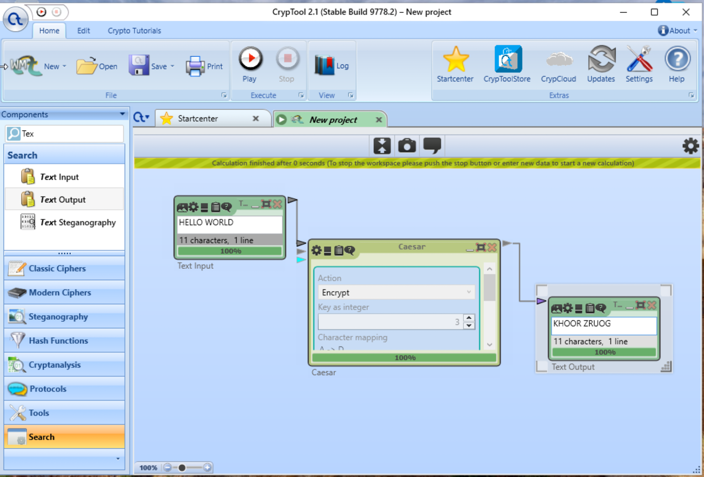
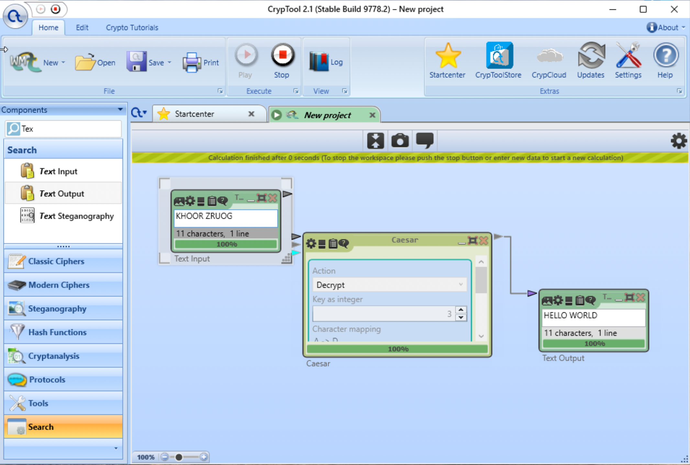
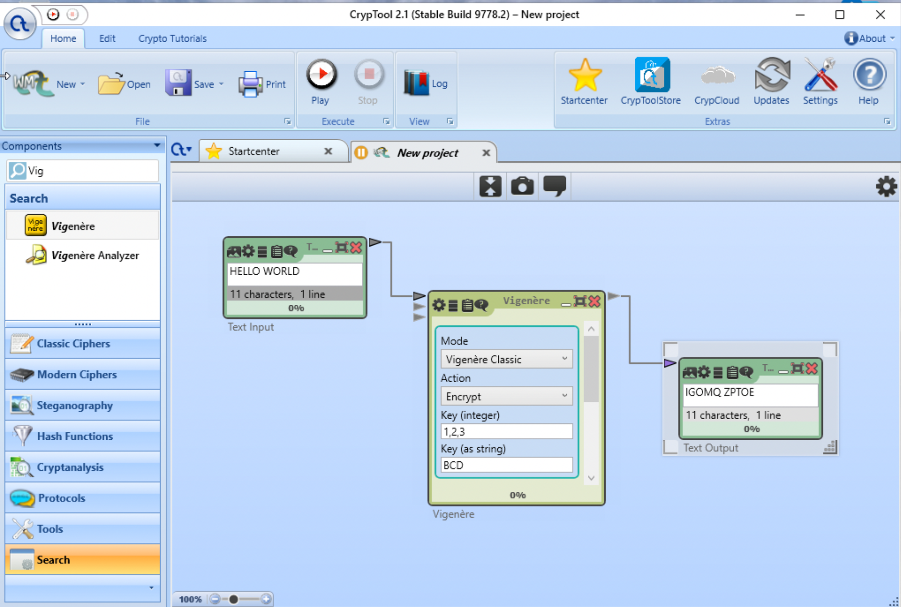
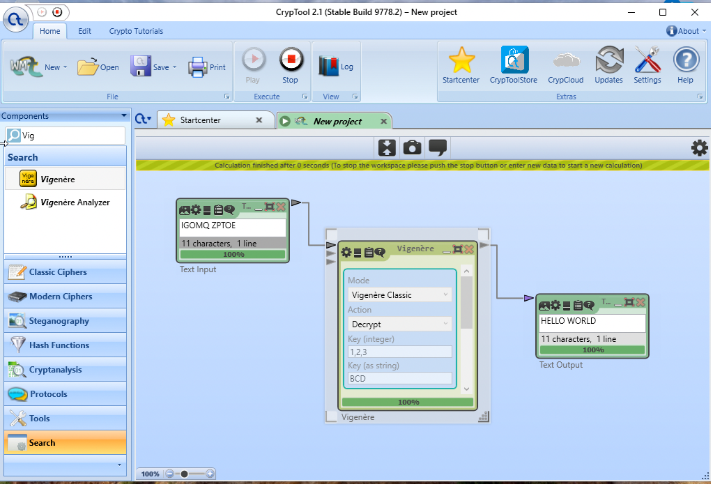
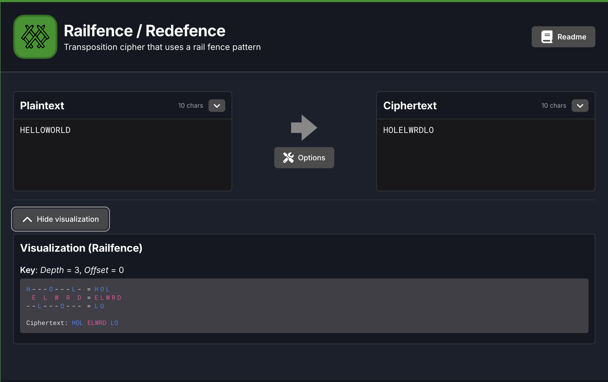
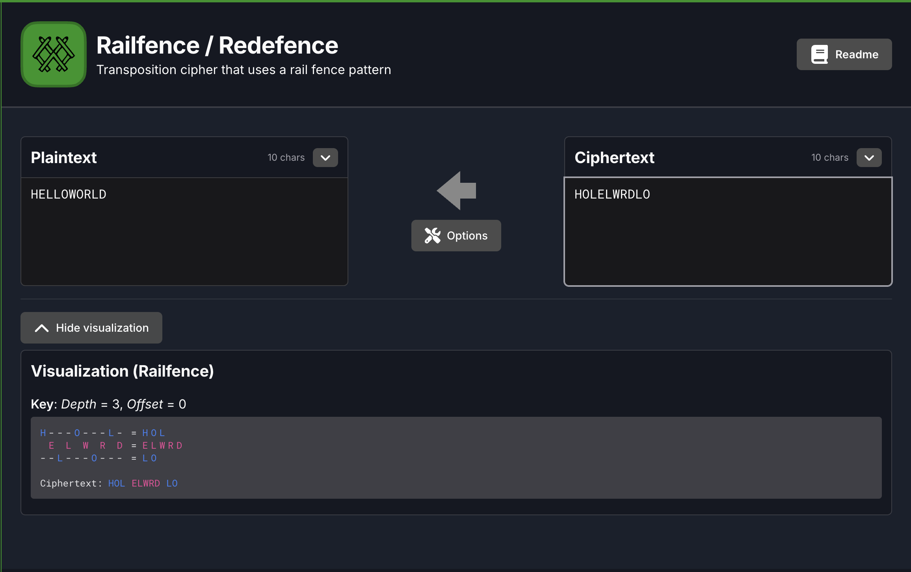

# Experiment 1: Implementation of Caesar, Vigenère, and Rail Fence Ciphers

## 1. Aim

To implement Caesar, Vigenère, and Rail Fence ciphers for encryption and decryption using CrypTool 2.1 and CrypTool Online, and compare their working processes and effectiveness.

## 2. Software and Tools Required

- **CrypTool 2.1:** For Caesar Cipher and Vigenère Cipher.
- **CrypTool Online:** For Rail Fence Cipher.
- **Web Browser:** To access CrypTool Online.
- **Operating System:** Windows (CrypTool 2.1 environment).

### Official Tool Links

- CrypTool 2: https://www.cryptool.org/en/ct2/
- CrypTool Online: https://www.cryptool.org/en/cto/

## 3. Theory

Classical cryptography uses different techniques to convert readable information (plaintext) into an unreadab
le form (ciphertext).

This experiment demonstrates three classical encryption techniques:

1. Caesar Cipher – Substitution Cipher.
2. Vigenère Cipher – Polyalphabetic Substitution Cipher.
3. Rail Fence Cipher – Transposition Cipher.

### A. Caesar Cipher

Caesar Cipher is a substitution encryption technique in which every letter of the plaintext is shifted by a fixed number of positions in the alphabet.

**Encryption Formula:**

C = (P + K) mod 26

**Decryption Formula:**

P = (C - K) mod 26

Where:
- P = Plaintext letter position.
- C = Ciphertext letter position.
- K = Encryption key (shift value).
- 26 = Number of letters in the English alphabet.

**Example:**

- Plaintext: `HELLO WORLD`
- Key: `3`
- Ciphertext: `KHOOR ZRUOG`

### B. Vigenère Cipher

Vigenère Cipher is a polyalphabetic substitution technique that uses a keyword to encrypt the plaintext. Each letter of the keyword determines the shift applied to the corresponding plaintext letter.

The keyword is repeated to match the number of alphabetic characters in the plaintext. Spaces are preserved and do not consume key characters.

**Encryption Formula:**

Cᵢ = (Pᵢ + Kᵢ) mod 26

**Decryption Formula:**

Pᵢ = (Cᵢ - Kᵢ) mod 26

Where:
- Pᵢ = Plaintext character position.
- Cᵢ = Ciphertext character position.
- Kᵢ = Corresponding key character position.

**Example:**

- Plaintext: `HELLO WORLD`
- Key: `KEY`
- Repeated key: `KEYKEYKEYK`
- Ciphertext: `RIJVS UYVJN`

### C. Rail Fence Cipher

Rail Fence Cipher is a transposition encryption technique in which plaintext characters are arranged in a zigzag pattern across a specified number of rails.

The ciphertext is generated by reading the characters row by row.

Unlike substitution ciphers, Rail Fence does not replace characters. It only changes their positions.

**Example:**

- Plaintext: `HELLOWORLD`
- Depth: `3`
- Offset: `0`
- Ciphertext: `HOLELWRDLO`

## 4. Algorithms

### A. Caesar Cipher

**Encryption Algorithm:**

1. Start.
2. Accept plaintext and an integer shift key.
3. Read each character of the plaintext.
4. Convert each alphabetic character into its numerical position (A = 0 to Z = 25).
5. Add the shift key to the character position.
6. Apply modulo 26.
7. Convert the resulting position back into an alphabetic character.
8. Preserve spaces and other non-alphabetic characters.
9. Display the ciphertext.
10. Stop.

**Decryption Algorithm:**

1. Start.
2. Accept ciphertext and the same shift key.
3. Read each character of the ciphertext.
4. Convert each alphabetic character into its numerical position.
5. Subtract the shift key from the character position.
6. Apply modulo 26.
7. Convert the resulting position back into an alphabetic character.
8. Preserve spaces and other non-alphabetic characters.
9. Display the decrypted plaintext.
10. Stop.

### B. Vigenère Cipher

**Encryption Algorithm:**

1. Start.
2. Accept plaintext and a keyword.
3. Repeat the keyword to match the number of alphabetic plaintext characters.
4. Convert plaintext and key characters into numerical positions.
5. Add the corresponding key position to each plaintext position.
6. Apply modulo 26.
7. Convert the resulting values into alphabetic characters.
8. Preserve spaces and other non-alphabetic characters.
9. Display the ciphertext.
10. Stop.

**Decryption Algorithm:**

1. Start.
2. Accept ciphertext and the original keyword.
3. Repeat the keyword to match the number of alphabetic ciphertext characters.
4. Convert ciphertext and key characters into numerical positions.
5. Subtract the corresponding key position from each ciphertext position.
6. Apply modulo 26.
7. Convert the resulting values into alphabetic characters.
8. Preserve spaces and other non-alphabetic characters.
9. Display the decrypted plaintext.
10. Stop.

### C. Rail Fence Cipher

**Encryption Algorithm:**

1. Start.
2. Accept plaintext and the number of rails (depth).
3. Remove spaces from the plaintext for this experiment.
4. Arrange the characters in a zigzag pattern across the specified number of rails.
5. Move downward through the rails and then upward repeatedly.
6. Read the characters row by row.
7. Display the ciphertext.
8. Stop.

**Decryption Algorithm:**

1. Start.
2. Accept ciphertext and the same number of rails.
3. Reconstruct the zigzag traversal pattern.
4. Determine the number of characters belonging to each rail.
5. Distribute ciphertext characters into their respective rails.
6. Read the characters following the original zigzag pattern.
7. Display the decrypted plaintext.
8. Stop.

## 5. Working Procedure

### A. Caesar Cipher using CrypTool 2.1

**Encryption:**

1. Open CrypTool 2.1.
2. Create a new workspace.
3. Add the Text Input component.
4. Add the Caesar Cipher component.
5. Add the Text Output component.
6. Connect the components in sequence:

   Text Input → Caesar Cipher → Text Output

7. Enter the plaintext `HELLO WORLD`.
8. Select the Caesar Cipher component.
9. Set the Action parameter to Encrypt.
10. Set the integer key to 3.
11. Execute the workflow using the Play button.
12. Observe and record the ciphertext.

**Decryption:**

1. Enter the ciphertext `KHOOR ZRUOG` in the Text Input component.
2. Change the Caesar Cipher Action parameter to Decrypt.
3. Keep the integer key unchanged at 3.
4. Execute the workflow.
5. Verify that the decrypted output is `HELLO WORLD`.

**Results:**

- Plaintext: `HELLO WORLD`
- Key: `3`
- Encrypted Text: `KHOOR ZRUOG`
- Decrypted Text: `HELLO WORLD`

### B. Vigenère Cipher using CrypTool 2.1

**Encryption:**

1. Open CrypTool 2.1.
2. Create a new workspace.
3. Add the Text Input component.
4. Add the Vigenère Cipher component.
5. Add the Text Output component.
6. Connect the components in sequence:

   Text Input → Vigenère Cipher → Text Output

7. Enter the plaintext `HELLO WORLD`.
8. Select the Vigenère Classic mode.
9. Set the Action parameter to Encrypt.
10. Enter the keyword `KEY`.
11. If the component displays an integer key field, use the corresponding values `10, 4, 24`.
12. Execute the workflow using the Play button.
13. Observe and record the ciphertext.

**Decryption:**

1. Enter the ciphertext `RIJVS UYVJN` in the Text Input component.
2. Change the Action parameter to Decrypt.
3. Keep the same keyword `KEY`.
4. Keep the corresponding integer key values unchanged.
5. Execute the workflow.
6. Verify that the decrypted output is `HELLO WORLD`.

**Results:**

- Plaintext: `HELLO WORLD`
- Key: `KEY`
- Encrypted Text: `RIJVS UYVJN`
- Decrypted Text: `HELLO WORLD`

### C. Rail Fence Cipher using CrypTool Online

**Encryption:**

1. Open CrypTool Online in a web browser.
2. Open the Railfence / Redefence application.
3. Select the Railfence variant.
4. Enter the plaintext `HELLOWORLD`.
5. Set the depth to 3.
6. Set the offset to 0.
7. Arrange the characters in a zigzag pattern across three rails.
8. Perform encryption.
9. Observe and record the ciphertext.

**Decryption:**

1. Enter the ciphertext `HOLELWRDLO` in the decryption input.
2. Select the same Railfence variant.
3. Keep the depth set to 3.
4. Keep the offset set to 0.
5. Perform decryption.
6. Verify that the recovered plaintext is `HELLOWORLD`.

**Results:**

- Plaintext: `HELLOWORLD`
- Depth: `3`
- Offset: `0`
- Encrypted Text: `HOLELWRDLO`
- Decrypted Text: `HELLOWORLD`

## 6. Screenshots

Screenshots of the encryption and decryption processes are included below as evidence of successful execution.

### A. Caesar Cipher

**Encryption Output**

**Decryption Output**

### B. Vigenère Cipher

**Encryption Output**

**Decryption Output**

### C. Rail Fence Cipher

**Encryption Output**

**Decryption Output**

### D. Environment Setup

Include screenshots showing:
- CrypTool 2.1 application and its workspace.
- CrypTool Online Rail Fence application.

## 7. Comparison of Encryption and Decryption Processes

| Feature | Caesar Cipher | Vigenère Cipher | Rail Fence Cipher |
|---|---|---|---|
| Cipher Type | Substitution | Polyalphabetic Substitution | Transposition |
| Key | Integer shift | Repeating keyword | Number of rails |
| Encryption Method | Shifts letters by a fixed number of positions | Shifts letters according to keyword characters | Rearranges characters in a zigzag pattern |
| Decryption Method | Shifts letters backward | Reverses the keyword-based shifts | Reconstructs the original zigzag arrangement |
| Example Key | 3 | KEY | 3 rails |
| Ciphertext | KHOOR ZRUOG | RIJVS UYVJN | HOLELWRDLO |
| Security | Very weak | Stronger than Caesar, but still weak | Very weak |

### Explanation

**Caesar Cipher:**
- Uses a single fixed shift value.
- Simple to implement and understand.
- Can be easily broken using brute-force attacks because it has only 26 possible shifts.

**Vigenère Cipher:**
- Uses a repeating keyword to generate different character shifts.
- More resistant to simple frequency analysis than Caesar Cipher.
- Vulnerable to cryptanalysis because of repeated-key patterns.

**Rail Fence Cipher:**
- Does not replace alphabetic characters.
- Changes the positions of characters using a zigzag arrangement.
- Preserves letter frequencies and provides weak security.

These classical ciphers are useful for understanding the fundamental concepts of encryption and decryption but are not suitable for modern secure communication.

## 8. Result

Successfully performed encryption and decryption using Caesar, Vigenère, and Rail Fence ciphers with CrypTool 2.1 and CrypTool Online.

The original plaintext was successfully recovered during decryption for all three algorithms.

The experiment also demonstrated the differences between substitution and transposition encryption techniques.

## 9. Conclusion

This experiment demonstrated three classical cryptographic algorithms and their encryption and decryption processes.

Caesar Cipher uses a fixed alphabetic shift, Vigenère Cipher uses a repeating keyword to perform multiple shifts, and Rail Fence Cipher rearranges characters using a zigzag pattern.

By implementing and comparing these techniques, the fundamental principles of classical cryptography, encryption, decryption, and key-based security were understood.

All three techniques have security limitations and are primarily useful for educational purposes.