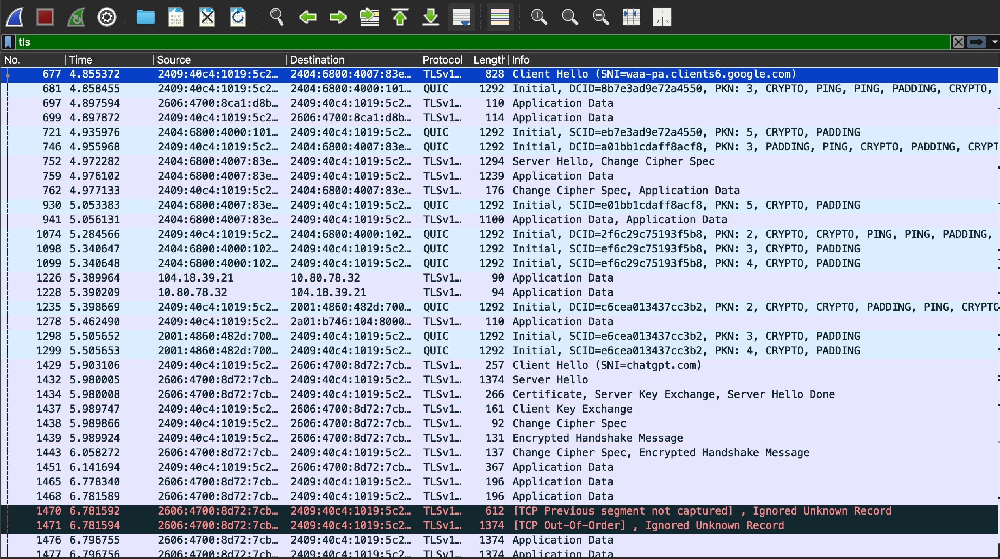
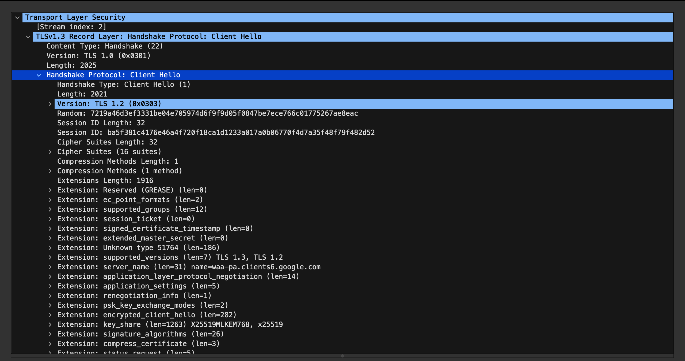
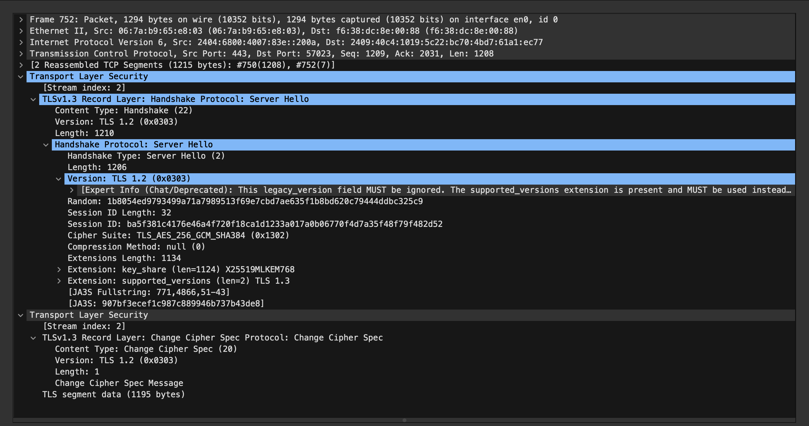
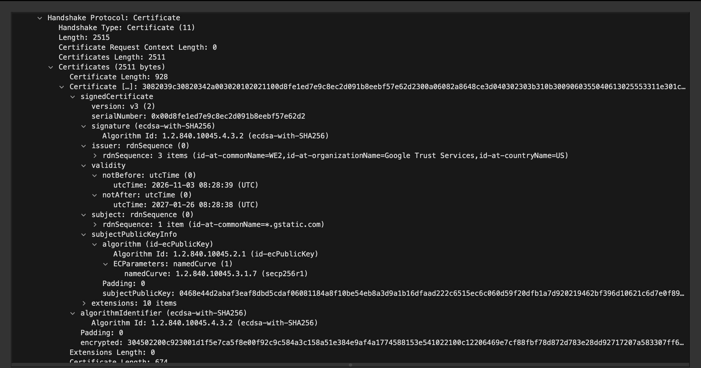
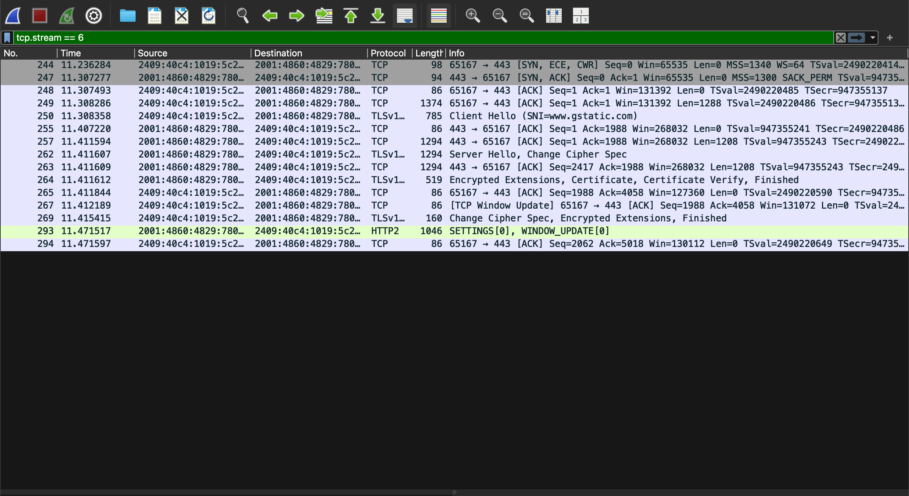

# Experiment 10: HTTPS/TLS Analysis Using Wireshark

## 1. Aim

To capture and analyze HTTPS traffic using Wireshark and study the TLS (Transport Layer Security) handshake process, the negotiated TLS version, the cipher suite, and the X.509 digital certificate.

## 2. Software and Tools Required

- macOS
- Wireshark (network protocol analyzer)
- Google Chrome
- Internet connection
- TLS key log file (for decrypting TLS handshake traffic)

## 3. Theory

### A. HTTPS and TLS

HTTPS (Hypertext Transfer Protocol Secure) is HTTP protected by TLS (Transport Layer Security). TLS secures the communication between a web browser and a web server.

TLS provides three important security properties:

1. **Confidentiality:** Encrypts transmitted data to prevent unauthorized access.
2. **Integrity:** Helps ensure that transmitted data has not been modified.
3. **Authentication:** Uses digital certificates to verify the identity of the server.

Wireshark is a network protocol analyzer used to capture and inspect network packets, including TLS handshake messages, certificates, and other protocol details.

### B. TLS Handshake

The TLS handshake establishes a secure connection before application data is exchanged.

| Message | Purpose |
|---|---|
| **Client Hello** | Client sends supported TLS versions, cipher suites, client random, extensions, and Server Name Indication (SNI). |
| **Server Hello** | Server selects the TLS version and cipher suite, and sends the server random and key exchange information. |
| **Certificate** | Server sends its digital certificate to prove its identity. |
| **Certificate Verify** | Server proves that it holds the private key matching its certificate. |
| **Finished** | Both parties confirm the integrity of the handshake. |

In TLS 1.3, the handshake messages after Server Hello are encrypted. A TLS key log file is therefore configured in Wireshark to decrypt them for analysis.

### C. Cipher Suite

A cipher suite defines the cryptographic algorithms used to secure communication.

**Example:** `TLS_AES_256_GCM_SHA384`

- **AES-256:** Symmetric encryption.
- **GCM:** Authenticated encryption mode.
- **SHA-384:** Hash function used in the TLS key schedule.

### D. X.509 Digital Certificate

An X.509 certificate binds a public key to an identity. It contains:

- Certificate version
- Serial number
- Subject
- Issuer
- Validity period
- Public key algorithm
- Signature algorithm

The certificate is digitally signed by a Certificate Authority (CA) to establish trust.

## 4. Working Procedure and Commands

### Step 1: Install and open Wireshark

Install Wireshark and launch it on macOS.

### Step 2: Configure Chrome to generate a TLS key log file

Set the `SSLKEYLOGFILE` environment variable so that Chrome writes TLS session keys to a file.

### Step 3: Configure Wireshark to use the key log file

In Wireshark, open **Preferences → Protocols → TLS** and set the **(Pre)-Master-Secret log filename** to the generated key log file.

### Step 4: Start the packet capture

Select the active Wi-Fi interface and start capturing packets.

### Step 5: Generate HTTPS traffic

Open Google Chrome, visit `https://www.google.com`, and refresh the page.

### Step 6: Stop the capture and filter TLS traffic

Stop the capture and apply the display filter:

```text
tls
```

### Step 7: Inspect the Client Hello and Server Hello

Locate the Client Hello message, then inspect the Server Hello to identify the negotiated TLS version and cipher suite.

### Step 8: Analyze the X.509 certificate

Inspect the Certificate handshake message to view the certificate details.

### Step 9: Examine the complete handshake

Apply the following filter to follow the full TCP connection:

```text
tcp.stream == 6
```

### Wireshark Display Filters Used

| Display Filter | Purpose |
|---|---|
| `tls` | Displays TLS traffic |
| `tls.handshake.type == 1` | Displays Client Hello messages |
| `tls.handshake.type == 2` | Displays Server Hello messages |
| `tls.handshake.type == 11` | Displays Certificate messages |
| `tcp.stream == 6` | Displays packets belonging to TCP stream 6 |

## 5. Screenshots

### 1. Captured TLS Traffic



### 2. Client Hello Message



### 3. Server Hello and Negotiated Cipher Suite



### 4. X.509 Certificate Details



### 5. Complete TLS Handshake Sequence



## 6. Analysis and Observations

### A. Client Hello

- Handshake Type: Client Hello
- Server Name Indication: `www.gstatic.com`
- Supported TLS Versions: TLS 1.3 and TLS 1.2
- Supported Key Shares: X25519MLKEM768 and X25519

### B. Server Hello

- Handshake Type: Server Hello
- Negotiated TLS Version: TLS 1.3
- Selected Cipher Suite: `TLS_AES_256_GCM_SHA384`
- Compression Method: Null
- Key Share: X25519MLKEM768

### C. X.509 Certificate

| Certificate Field | Observed Value |
|---|---|
| Version | X.509 v3 |
| Serial Number | `0x00d8fe1ed7e9c8ec2d091b8eebf57e62d2` |
| Subject | `*.gstatic.com` |
| Issuer | Google Trust Services (WE2) |
| Valid From | 03 November 2026 |
| Valid Until | 26 January 2027 |
| Public Key Algorithm | Elliptic Curve (EC) |
| Elliptic Curve | secp256r1 |
| Signature Algorithm | ECDSA with SHA-256 |

### D. TLS Handshake Sequence (TCP Stream 6)

| Packet Number | Observed Message |
|---|---|
| 250 | Client Hello |
| 262 | Server Hello, Change Cipher Spec |
| 264 | Encrypted Extensions, Certificate, Certificate Verify, Finished |
| 269 | Change Cipher Spec, Encrypted Extensions, Finished |
| 293 | HTTP/2 communication |

The encrypted handshake messages were inspected after configuring TLS decryption in Wireshark.

## 7. Result

HTTPS traffic was successfully captured and analyzed using Wireshark. The Client Hello and Server Hello messages were identified, the negotiated TLS 1.3 version and cipher suite were verified, and the X.509 certificate was examined, including its subject, issuer, validity period, public key algorithm, and signature algorithm.

## 8. Conclusion

This experiment demonstrated the TLS handshake process by examining the Client Hello, Server Hello, Certificate, and Finished messages. It showed how TLS provides confidentiality, integrity, and authentication during secure network communication, and how digital certificates establish trust in the server's identity.

## 9. Security Note

- A TLS key log file contains session secrets that can decrypt captured traffic. Keep it private and delete it after the experiment.
- Unset `SSLKEYLOGFILE` after the experiment so the browser stops logging keys.
- Packet captures can contain IP addresses, hostnames, and other metadata. Review them before sharing.
