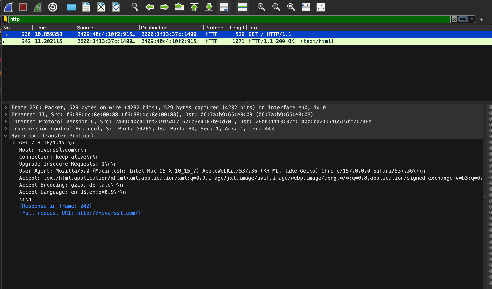
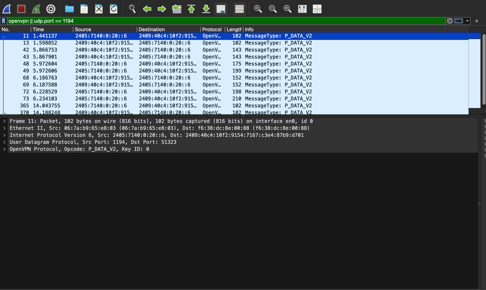
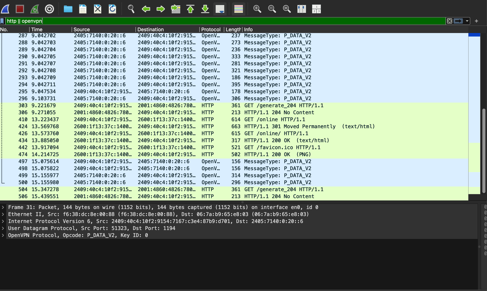

# Experiment 11: VPN Traffic Analysis Using OpenVPN and Wireshark

## 1. Aim

To configure OpenVPN CloudConnexa on macOS and use Wireshark to capture and compare:

- ordinary HTTP traffic,
- OpenVPN tunnel traffic, and
- HTTP and OpenVPN traffic in a combined capture.

## 2. Software and Tools Required

- macOS (MacBook Air M3)
- OpenVPN CloudConnexa (trial)
- OpenVPN Connect (VPN client)
- Wireshark
- Capture interface: `en0` (physical Wi-Fi interface)
- HTTP test site: `http://neverssl.com`

## 3. Theory

### A. Virtual Private Network (VPN)

A VPN creates an encrypted tunnel between a device and a VPN server. Traffic sent through the tunnel is encapsulated and encrypted, so an observer on the local network sees only VPN packets instead of the original application data.

### B. OpenVPN

OpenVPN is an open-source VPN protocol that uses TLS for key exchange and commonly runs over **UDP port 1194**. Encrypted user data is carried in data-channel packets such as `P_DATA_V2`.

### C. HTTP vs VPN Traffic

| Feature | Plain HTTP | OpenVPN Tunnel |
|---|---|---|
| Encryption | None | Encrypted tunnel |
| Visible in Wireshark | Request lines, headers, responses | `P_DATA_V2` packets over UDP/1194 |
| Payload readable | Yes | No |

### D. Split Tunneling

With split tunneling enabled, only some traffic is routed through the VPN while other traffic uses the normal network. As a result, both VPN packets and ordinary traffic can appear in the same capture.

## 4. Working Procedure and Commands

### Step 1: Set up CloudConnexa

1. Sign in to the CloudConnexa administration portal.
2. Open **Users → Devices** and choose **Add Device**.
3. Create a device named `MacBook-Air-M3` and assign it to the intended user.
4. Download the device profile.

### Step 2: Connect using OpenVPN Connect

Import the profile into OpenVPN Connect and connect to the CloudConnexa network. The tested endpoint displayed Mumbai.

The connection can also be checked from Terminal:

```bash
scutil --nc list
```

### Step 3: Capture the HTTP baseline (VPN disconnected)

1. Disconnect OpenVPN Connect.
2. Start a Wireshark capture on `en0`.
3. Open `http://neverssl.com` (HTTP, not HTTPS) and let the page load.
4. Stop the capture and apply the filter:

```text
http
```

5. Inspect the HTTP GET request and server response.
6. Save the capture as `Captures/Exp11_HTTP_Baseline.pcapng`.

### Step 4: Capture OpenVPN traffic (VPN connected)

1. Connect OpenVPN Connect to CloudConnexa.
2. Start a new capture on `en0` and generate network traffic.
3. Stop the capture and apply the filter:

```text
openvpn || udp.port == 1194
```

4. Save the capture as `Captures/Exp11_VPN_Traffic.pcapng`.

### Step 5: Capture combined HTTP and OpenVPN traffic

1. Keep OpenVPN connected.
2. Start a new capture on `en0` and visit `http://neverssl.com`.
3. Stop the capture and apply the filter:

```text
http || openvpn
```

4. Save the capture as `Captures/Exp11_Combined_Traffic.pcapng`.

### Wireshark Display Filters Used

| Display Filter | Purpose |
|---|---|
| `http` | Displays packets dissected as HTTP |
| `openvpn` | Displays packets dissected as OpenVPN |
| `udp.port == 1194` | Displays UDP packets using port 1194 |
| `http \|\| openvpn` | Displays HTTP and OpenVPN packets together |

## 5. Screenshots

### 1. HTTP Baseline Traffic

The HTTP request and response headers are readable in plain text.



### 2. OpenVPN Encrypted Traffic

OpenVPN `P_DATA_V2` data-channel packets over UDP port 1194.



### 3. HTTP vs OpenVPN in a Combined Capture



## 6. Analysis and Observations

### A. Packet Capture Summary

| Capture File | Packets | Observations |
|---|---:|---|
| `Captures/Exp11_HTTP_Baseline.pcapng` | 405 | NeverSSL HTTP request/response; no UDP/1194 packets |
| `Captures/Exp11_VPN_Traffic.pcapng` | 370 | 12 UDP/1194 packets; also contains plain HTTP to `example.com` |
| `Captures/Exp11_Combined_Traffic.pcapng` | 532 | 34 UDP/1194 packets and HTTP requests/responses to NeverSSL |

### B. HTTP Baseline

- HTTP requests to `coolshininglushlight.neverssl.com`.
- `GET /online` followed by `HTTP/1.1 301 Moved Permanently`.
- `GET /online/` followed by `HTTP/1.1 200 OK`.
- A `/favicon.ico` request with an HTTP 200 response.
- No UDP packets on port 1194.

### C. OpenVPN Traffic

- 12 UDP packets on port 1194, identified as OpenVPN `P_DATA_V2`.
- The capture also contains readable HTTP traffic to `example.com` on TCP port 80, so not every packet in this file is encrypted VPN traffic. This is consistent with split-tunnel routing.

### D. Combined Capture

- 34 UDP packets on port 1194 with OpenVPN `P_DATA_V2` packets.
- Readable HTTP traffic: `GET /online`, `301 Moved Permanently`, `GET /online/`, `200 OK`, and a favicon request/response.
- Because Split Tunnel was enabled, HTTP and OpenVPN packets appear together as different flows taking different routes.

### E. Key Observations

1. HTTP request lines, headers, and responses were readable in the baseline capture.
2. OpenVPN data-channel traffic was identified as `P_DATA_V2` over UDP port 1194.
3. Seeing OpenVPN packets does not by itself prove that all traffic is routed through the VPN.
4. Split tunneling determines which flows use the VPN tunnel.

## 7. Result

OpenVPN CloudConnexa was successfully configured on macOS, and Wireshark captures were collected for an HTTP baseline, OpenVPN traffic, and combined HTTP/OpenVPN traffic. The captures contain the protocol evidence described above.

## 8. Conclusion

This experiment demonstrated how Wireshark can distinguish ordinary HTTP traffic from OpenVPN tunnel traffic. HTTP headers were readable in plain text, while OpenVPN traffic appeared only as encrypted data-channel packets on UDP port 1194. The combined capture showed why split-tunnel configuration and per-flow routing must be considered before concluding that all traffic is protected by a VPN.

## 9. Security Note

- Packet captures can contain IP addresses, hostnames, URLs, and other metadata. Review them before sharing.
- Never include VPN profiles, private keys, passwords, or authentication tokens in a submission.
- Use full-tunnel mode when all traffic must be protected by the VPN.
