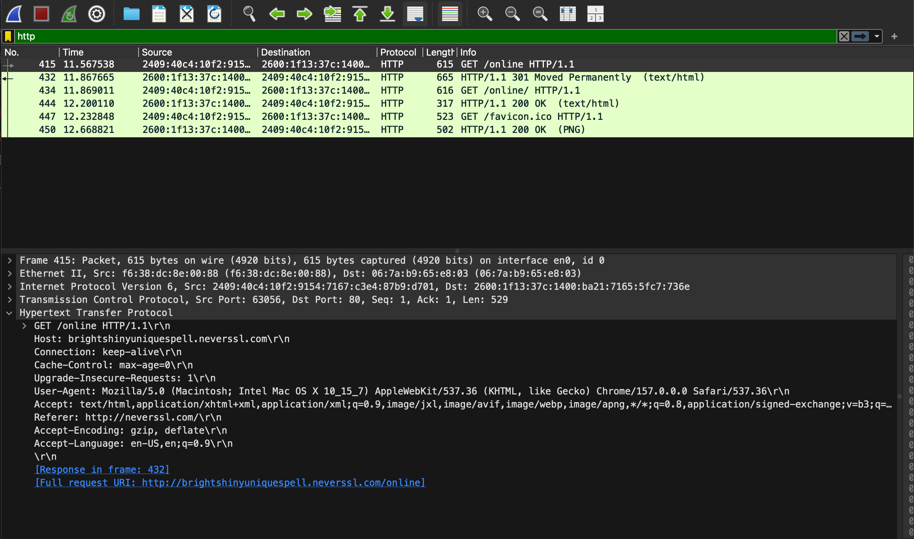
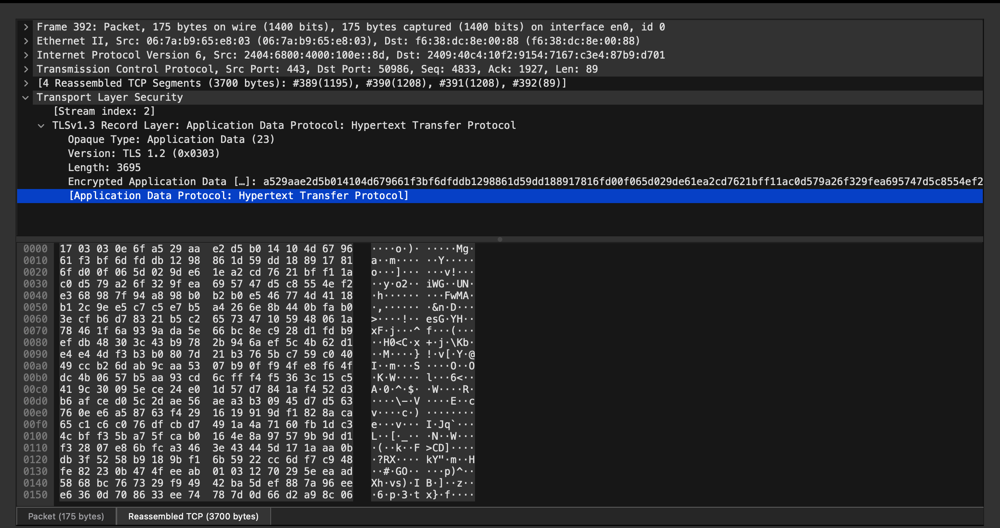
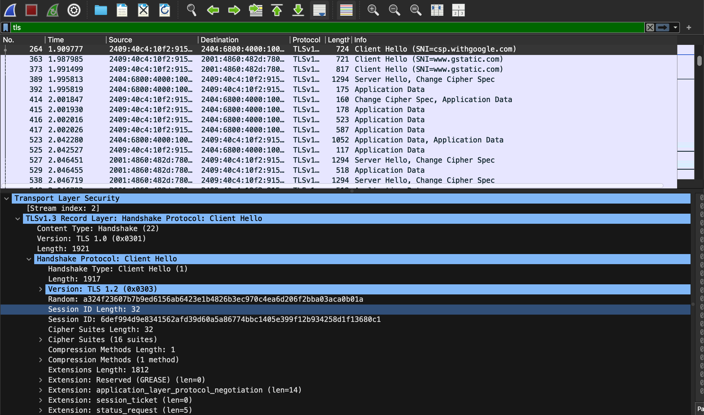
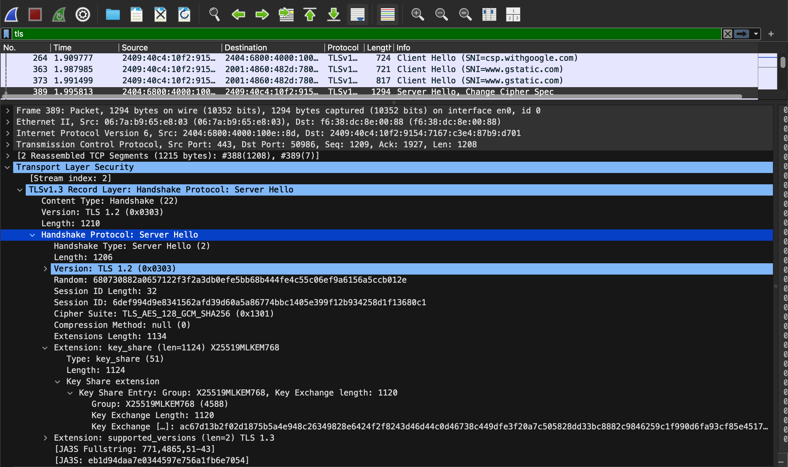

# Experiment 12: Analysis of HTTP and HTTPS Traffic Using Wireshark

## 1. Aim

To capture and analyze HTTP and HTTPS network traffic using Wireshark, and to compare the visibility of data in an unencrypted HTTP connection with the encrypted application data carried by HTTPS.

## 2. Software and Tools Required

- macOS
- Wireshark
- Google Chrome
- Active network connection (capture interface: `en0`)

## 3. Theory

### A. HTTP

Hypertext Transfer Protocol (HTTP) is an application-layer protocol used for communication between a web browser and a web server. In a plain HTTP connection, the request method, path, host, and headers can be read directly in a packet capture.

### B. HTTPS

HTTPS is HTTP protected by TLS (Transport Layer Security). During connection setup, the client and server exchange handshake messages to negotiate security parameters and establish keys. After the handshake, application data is encrypted.

A packet capture can still reveal some metadata, such as packet sizes, TLS record types, and the server name, but the application payload is not readable as plain HTTP.

### C. Difference Between HTTP and HTTPS

| Feature | HTTP | HTTPS |
|---|---|---|
| Transport protection | No TLS protection | Protected using TLS |
| Request headers in capture | Readable | Encrypted inside application data |
| Confidentiality | Not provided | Provided by TLS encryption |
| Typical Wireshark evidence | HTTP GET and response status | TLS Client Hello, Server Hello, and Application Data |

## 4. Working Procedure and Commands

### Part A: HTTP Packet Capture

#### Step 1: Start the capture

Open Wireshark, select the active interface (`en0`), and start capturing packets.

#### Step 2: Generate HTTP traffic

Open a browser and visit `http://neverssl.com/`. Allow the page to load.

#### Step 3: Filter HTTP packets

Stop the capture and apply the display filter:

```text
http
```

#### Step 4: Inspect the HTTP request

Select the HTTP GET request and inspect its packet details and headers.

### Part B: HTTPS/TLS Packet Capture

#### Step 5: Start a new capture

Start a new capture on the active network interface.

#### Step 6: Generate HTTPS traffic

Open a browser and visit `https://www.google.com/`. Allow the page to load.

#### Step 7: Filter TLS packets

Stop the capture and apply the display filter:

```text
tls
```

#### Step 8: Inspect the TLS handshake and application data

Locate the Client Hello, Server Hello, and Application Data packets and inspect their details.

## 5. Screenshots

### 1. HTTP Request Headers

The HTTP GET request and its headers are readable in plain text.



### 2. TLS Encrypted Application Data

The TLS Application Data record contains an encrypted payload.



### 3. TLS Client Hello



### 4. TLS Server Hello

The Server Hello shows the selected cipher suite and key-share details.



## 6. Analysis and Observations

### A. HTTP Capture

| Packet | Observation |
|---:|---|
| 415 | `GET /online HTTP/1.1` |
| 432 | `301 Moved Permanently` |
| 434 | `GET /online/ HTTP/1.1` |
| 444 | `200 OK` |
| 447, 450 | Favicon request and successful PNG response |

- The request contained readable headers including `Host`, `User-Agent`, `Accept`, `Referer`, `Connection`, and `Accept-Encoding`.

### B. HTTPS Capture

| Packet | Observation |
|---:|---|
| — | TLS Client Hello messages with server names such as `www.gstatic.com` |
| 389 | Server Hello with cipher suite `TLS_AES_128_GCM_SHA256` and key-exchange group `X25519MLKEM768` |
| 392 | TLS Application Data with an encrypted payload |

- The TLS records display legacy version values such as `0x0303`. These do not mean the connection used TLS 1.2. The Server Hello's Supported Versions extension shows that **TLS 1.3** was negotiated.
- No decrypted HTTP content was visible in the HTTPS capture.

## 7. Result

HTTP and HTTPS traffic was successfully captured and inspected using Wireshark on macOS. The HTTP capture exposed the GET request and its headers in readable form, while the HTTPS capture showed only TLS handshake messages and encrypted application data.

## 8. Conclusion

This experiment demonstrated the security difference between HTTP and HTTPS. HTTP does not provide encryption, so request information is visible in a packet capture. HTTPS uses TLS to protect application data in transit, while still exposing some handshake and connection metadata.

## 9. Security Note

- Avoid sending sensitive information such as passwords or personal data over plain HTTP.
- HTTPS hides the content of communication, but metadata such as the server name (SNI), IP addresses, and packet sizes remain visible.
- Packet captures can contain sensitive network information. Review them before sharing.
