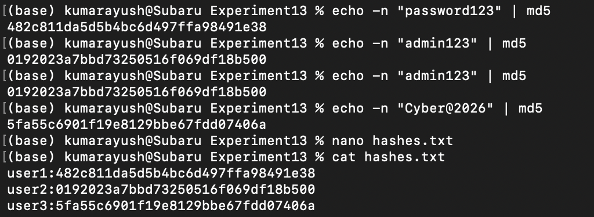
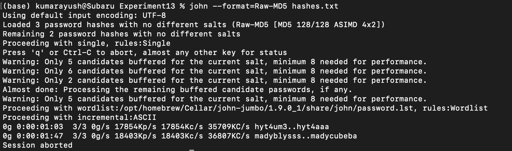
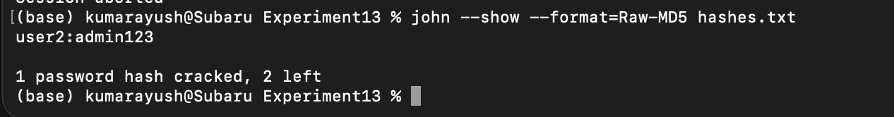
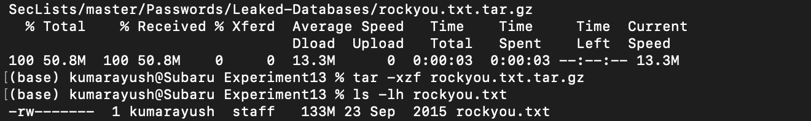
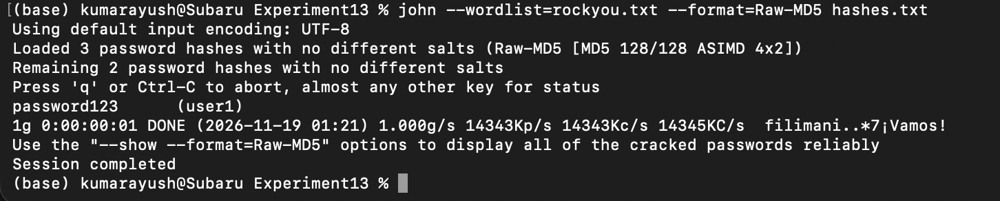
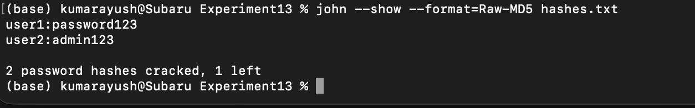

# Experiment 13: Password Auditing Using John the Ripper

## 1. Aim

To perform password auditing using John the Ripper and evaluate password strength by identifying weak passwords through dictionary-based password cracking.

## 2. Software and Tools Required

- macOS (Apple Silicon)
- Terminal
- Homebrew
- John the Ripper Jumbo 1.9.0
- Sample MD5 password hashes
- RockYou wordlist (`rockyou.txt`)

> **Scope:** This practical uses only three locally generated sample passwords and their hashes. No real user accounts or credentials were tested.

## 3. Theory

### A. Password Auditing

Password auditing is the process of testing stored password hashes to find weak or easily guessed passwords. It helps administrators identify accounts that need stronger passwords.

### B. John the Ripper

John the Ripper is an open-source password auditing tool. It supports many hash formats and provides several cracking modes:

- **Single crack mode:** Uses usernames and related information as guesses.
- **Wordlist mode:** Tries every password in a dictionary file.
- **Incremental mode:** Tries all character combinations (brute force).

The **Jumbo** version adds support for more hash formats, including `Raw-MD5`.

### C. MD5 Hashing

MD5 produces a 128-bit hash value. It is very fast, which makes it easy to test millions of guesses per second. This makes it unsuitable for storing real passwords.

### D. Dictionary Attack

A dictionary attack hashes each word from a wordlist and compares the result with the target hash. The **RockYou** wordlist contains millions of real passwords from a historical data leak and is commonly used in password auditing.

## 4. Working Procedure and Commands

### Step 1: Install John the Ripper Jumbo

The standard Homebrew `john` package did not support the `Raw-MD5` format, so it was replaced with the Jumbo build:

```bash
brew uninstall john
brew install john-jumbo
```

Verify that the `Raw-MD5` format is available:

```bash
john --list=formats | grep -i md5
```

### Step 2: Create the experiment directory

```bash
mkdir -p ~/Desktop/CryptoGithutPractical/Experiment13
cd ~/Desktop/CryptoGithutPractical/Experiment13
```

### Step 3: Generate sample MD5 hashes

```bash
echo -n "password123" | md5
echo -n "admin123" | md5
echo -n "Cyber@2026" | md5
```

| Username | Sample Password | MD5 Hash |
|---|---|---|
| user1 | `password123` | `482c811da5d5b4bc6d497ffa98491e38` |
| user2 | `admin123` | `0192023a7bbd73250516f069df18b500` |
| user3 | `Cyber@2026` | `5fa55c6901f19e8129bbe67fdd07406a` |

### Step 4: Create the hash file

Save the hashes in `hashes.txt` using the `username:hash` format:

```text
user1:482c811da5d5b4bc6d497ffa98491e38
user2:0192023a7bbd73250516f069df18b500
user3:5fa55c6901f19e8129bbe67fdd07406a
```

```bash
cat hashes.txt
```

### Step 5: Perform the initial password audit

```bash
john --format=Raw-MD5 hashes.txt
```

John loaded all three hashes and ran its default single, wordlist, and incremental modes. The incremental run was stopped manually.

Display the recovered passwords:

```bash
john --show --format=Raw-MD5 hashes.txt
```

At this stage, `admin123` was recovered for `user2`.

### Step 6: Download and extract the RockYou wordlist

```bash
curl -L -o rockyou.txt.tar.gz https://raw.githubusercontent.com/danielmiessler/SecLists/master/Passwords/Leaked-Databases/rockyou.txt.tar.gz
tar -xzf rockyou.txt.tar.gz
ls -lh rockyou.txt
```

The extracted `rockyou.txt` file was approximately 133 MB.

### Step 7: Perform the dictionary attack

```bash
john --wordlist=rockyou.txt --format=Raw-MD5 hashes.txt
```

John found `password123` for `user1` in the RockYou wordlist.

### Step 8: Display the final recovered passwords

```bash
john --show --format=Raw-MD5 hashes.txt
```

**Output:**

```text
user1:password123
user2:admin123

2 password hashes cracked, 1 left
```

## 5. Screenshots

### 1. MD5 Hash Generation and Hash File



### 2. Initial John the Ripper Audit



### 3. Initial Cracked Password (admin123)



### 4. RockYou Wordlist Download and Extraction



### 5. RockYou Dictionary Attack



### 6. Final Recovered Passwords



## 6. Analysis and Observations

| S. No. | Password | Dictionary Attack Result | Strength Assessment |
|---:|---|---|---|
| 1 | `123456` | Not tested | Very Weak |
| 2 | `password123` | Cracked (RockYou dictionary attack) | Weak |
| 3 | `admin123` | Cracked (initial audit) | Weak |
| 4 | `Cyber@2026` | Not cracked in the performed run | Moderate |
| 5 | `T9#mQ2$vLp8!` | Not tested | Strong |

1. All three sample MD5 hashes were loaded successfully by John the Ripper.
2. `admin123` was recovered during the initial audit.
3. `password123` was recovered using the RockYou wordlist.
4. `Cyber@2026` was not recovered. This does not prove it cannot be cracked; it was only not found in the attacks performed.
5. `123456` and `T9#mQ2$vLp8!` were included only as strength-evaluation examples from the lab manual and were not tested.

## 7. Result

Password auditing was successfully performed using John the Ripper. Three sample MD5 hashes were generated and tested. The initial audit recovered `admin123`, and the RockYou dictionary attack recovered `password123`. The final report showed **2 password hashes cracked and 1 remaining**.

## 8. Conclusion

This experiment demonstrated that common and predictable passwords can be recovered quickly through dictionary-based attacks. Strong passwords that are long, random, and use a mix of character types are much harder to crack, although a password not found by one wordlist is not necessarily immune to other attacks.

## 9. Precautions

1. Perform password auditing only on systems and hashes for which authorization has been granted.
2. Never use real user passwords for classroom demonstrations.
3. Use sample password hashes for practical experiments.
4. Avoid storing passwords in plaintext.

## 10. Security Note

- MD5 is used here only because the lab manual specifies it for a simple demonstration. It is fast and unsuitable for storing real passwords.
- Real applications should use dedicated password-hashing algorithms such as Argon2id, bcrypt, or scrypt, with unique salts.
- The RockYou wordlist is not included in this repository because of its size. Download it separately to reproduce the dictionary attack.
