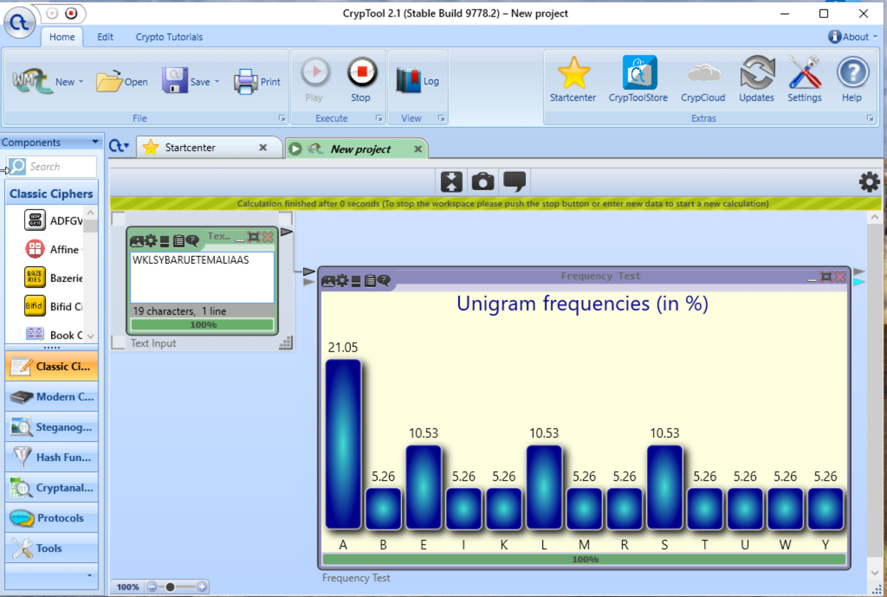

# Experiment 2: Frequency Analysis

## 1. Aim

To perform frequency analysis on a given text using CrypTool 2.1 and analyze the frequency distribution of individual characters using the Frequency Test component.

## 2. Software Requirements

- CrypTool 2.1 (Stable Build 9778.2)
- Windows operating system
- CrypTool 2.1 workspace

## 3. Theory

Frequency Analysis is a cryptanalysis technique used to study the occurrence of individual letters or characters in a given text.

In the English language, some letters occur more frequently than others. For example, E, T, A, O and I are among the most frequently occurring letters.

By analyzing the frequency distribution of characters in ciphertext, cryptanalysts can identify statistical patterns that may help reveal information about the original plaintext.

Frequency analysis is particularly useful against classical substitution ciphers because substitution generally preserves the frequency patterns of the original language, although the letters themselves are changed.

### Types of Frequency Analysis

**1. Unigram Frequency Analysis**

It calculates the frequency of individual characters in a text.

**2. Bigram Frequency Analysis**

It examines the frequency of pairs of consecutive characters.

**3. Trigram Frequency Analysis**

It examines the frequency of groups of three consecutive characters.

In this experiment, Unigram Frequency Analysis is performed using the Frequency Test component in CrypTool 2.1.

## 4. Formula

The percentage frequency of a character is calculated using:

Frequency (%) = (Number of occurrences of a character / Total number of characters) × 100

For example, if a character occurs 4 times in a text containing 19 characters:

Frequency = (4 / 19) × 100

Frequency = 21.05%

## 5. Algorithm

1. Start.
2. Open CrypTool 2.1.
3. Create a new workspace.
4. Enter the input text using the Text Input component.
5. Add the Frequency Test component.
6. Connect the Text Input component to the Frequency Test component.
7. Execute the workflow.
8. Analyze the generated unigram frequency distribution.
9. Identify the most frequently occurring characters.
10. Record the frequency percentages.
11. Stop.

## 6. Working Procedure

### Step 1: Open CrypTool 2.1

Launch CrypTool 2.1 and create a new project or workspace.

### Step 2: Add Text Input Component

1. Open the Components panel.
2. Locate the Text Input component.
3. Drag it into the workspace.
4. Enter the following sample text:

   `WKLSYBARUETEMALIAAS`

### Step 3: Add Frequency Test Component

1. Search for Frequency Test in the Components panel.
2. Drag the Frequency Test component into the workspace.
3. Place it to the right of the Text Input component.

### Step 4: Connect the Components

Connect the output of the Text Input component to the input of the Frequency Test component.

The workflow is:

Text Input → Frequency Test

### Step 5: Execute the Workflow

1. Verify the input text.
2. Check the component connection.
3. Click the Play button.
4. Wait for the calculation to finish.
5. Observe the unigram frequency distribution graph.

### Step 6: Analyze the Results

The Frequency Test component displays the percentage frequency of each character in the input text.

Observe the graph and record the frequency of each character.

## 7. Input Details

| Parameter | Value |
|---|---|
| Input Text | WKLSYBARUETEMALIAAS |
| Total Characters | 19 |
| Analysis Type | Unigram Frequency Analysis |
| Tool | CrypTool 2.1 |
| Component | Frequency Test |

## 8. Observations

The Frequency Test component generated the following frequency distribution:

| Character | Occurrences | Frequency |
|---|---:|---:|
| A | 4 | 21.05% |
| B | 1 | 5.26% |
| E | 2 | 10.53% |
| I | 1 | 5.26% |
| K | 1 | 5.26% |
| L | 2 | 10.53% |
| M | 1 | 5.26% |
| R | 1 | 5.26% |
| S | 2 | 10.53% |
| T | 1 | 5.26% |
| U | 1 | 5.26% |
| W | 1 | 5.26% |
| Y | 1 | 5.26% |

### Observation Summary

- Total characters analyzed: 19.
- Most frequent character: A.
- Frequency of A: 21.05%.
- Characters E, L and S occur twice each.
- The remaining characters occur once each.

## 9. Screenshot

### Frequency Analysis Output

The following screenshot shows the CrypTool 2.1 workspace, input text, Frequency Test component and generated unigram frequency graph.

## 10. Result

Successfully performed Frequency Analysis using CrypTool 2.1.

The Frequency Test component analyzed the given input text and generated a unigram frequency distribution showing the occurrence and percentage frequency of individual characters.

The character A was identified as the most frequently occurring character, with a frequency of 21.05%.

## 11. Conclusion

In this experiment, Frequency Analysis was performed using CrypTool 2.1.

The experiment demonstrated how character frequency distributions can be generated and analyzed to identify patterns in a given text.

Frequency analysis is an important cryptanalysis technique that can help identify weaknesses in classical substitution ciphers and assist in analyzing encrypted messages.