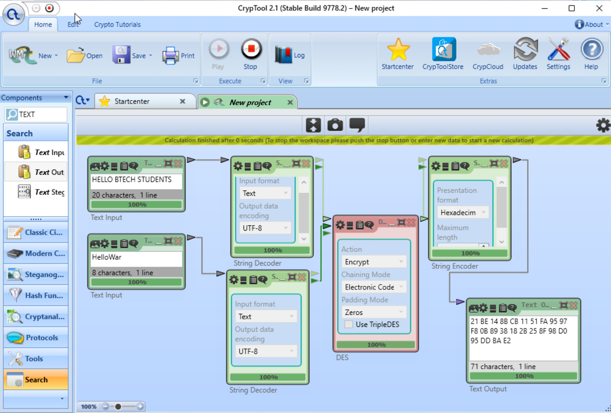
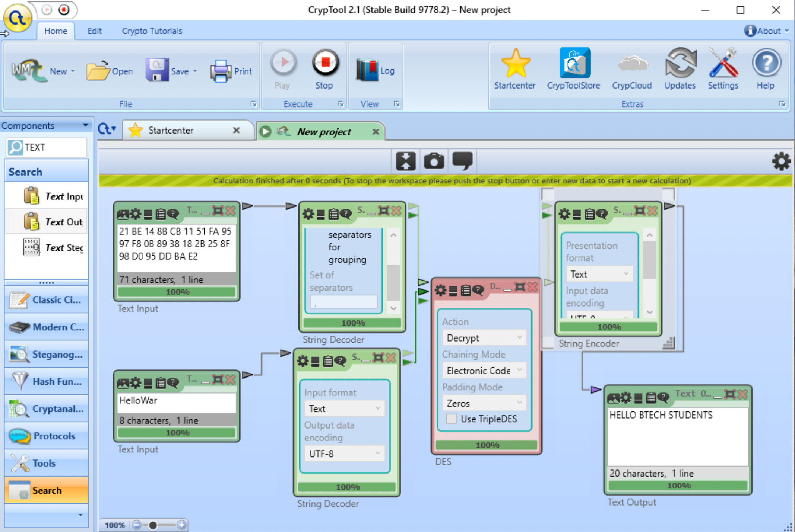
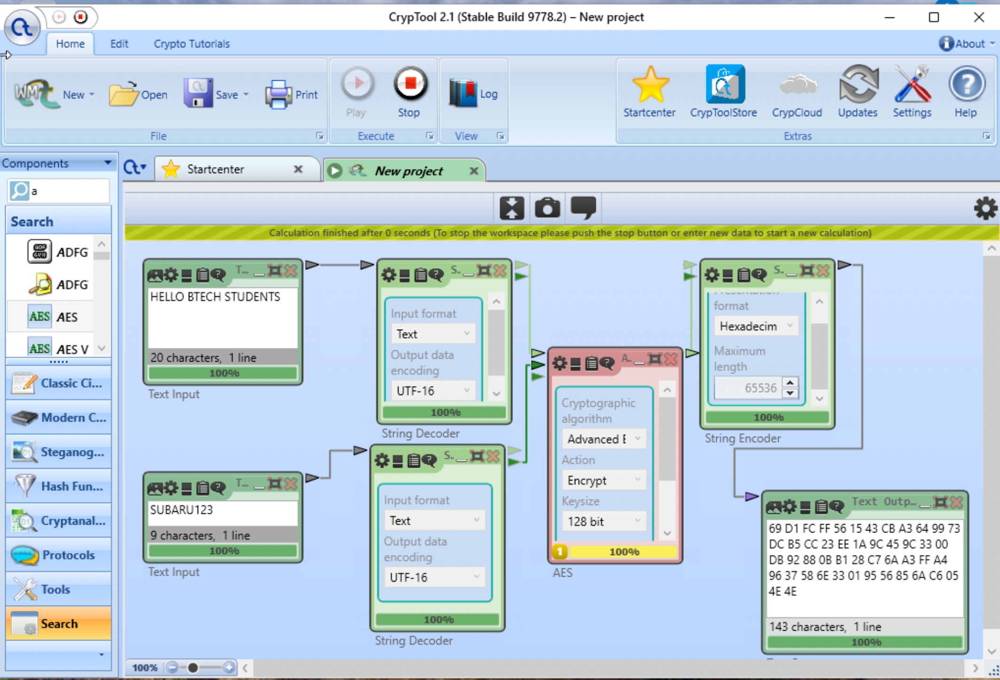
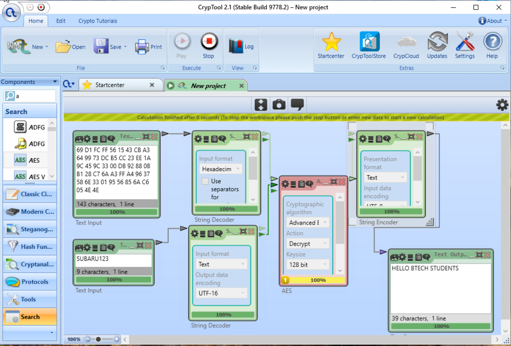

# Experiment 3: DES and AES Encryption and Decryption Using CrypTool

## 1. Aim

To perform encryption and decryption using DES (Data Encryption Standard) and AES (Advanced Encryption Standard) algorithms in CrypTool 2.1 and understand the working of symmetric-key cryptography.

## 2. Tools Required

- Operating System: Windows
- Software: CrypTool 2.1
- Computer or Laptop

## 3. Theory

### A. DES (Data Encryption Standard)

DES is a symmetric-key block cipher used for encrypting and decrypting data. It uses the same secret key for both encryption and decryption.

**Features of DES:**
- Effective key size: 56 bits.
- Block size: 64 bits.
- Number of rounds: 16.
- Encryption type: Symmetric-key encryption.
- DES uses a Feistel network structure.

DES is considered insecure for modern applications because its effective key size is too small.

### B. AES (Advanced Encryption Standard)

AES is a symmetric-key block cipher designed to provide stronger security than DES. It uses the same secret key for encryption and decryption.

**Features of AES:**
- Block size: 128 bits.
- Supported key sizes: 128, 192 and 256 bits.
- Number of rounds: 10, 12 and 14 respectively.
- Encryption type: Symmetric-key encryption.
- AES uses a substitution-permutation network structure.

AES is widely used in modern cryptographic applications because of its strong security and efficiency.

### C. Symmetric-Key Cryptography

Symmetric-key cryptography is an encryption technique in which the same secret key is used for both encryption and decryption.

**Encryption:**

Plaintext + Secret Key → Ciphertext

**Decryption:**

Ciphertext + Same Secret Key → Plaintext

## 4. Comparison Between DES and AES

| Feature | DES | AES |
|---|---|---|
| Full Form | Data Encryption Standard | Advanced Encryption Standard |
| Algorithm Type | Symmetric Block Cipher | Symmetric Block Cipher |
| Block Size | 64 bits | 128 bits |
| Effective Key Size | 56 bits | 128, 192, 256 bits |
| Number of Rounds | 16 | 10, 12, 14 |
| Structure | Feistel Network | Substitution-Permutation Network |
| Security | Weak | Strong |
| Modern Usage | Obsolete for security | Widely used |

## 5. Algorithms

### A. DES Encryption and Decryption

**Encryption Algorithm:**

1. Start.
2. Open CrypTool 2.1.
3. Create a new workspace.
4. Add the Text Input component and enter the plaintext.
5. Add a String Decoder to convert the input text into bytes.
6. Add the DES component.
7. Provide the secret key through a separate Text Input and String Decoder.
8. Configure the DES component with the required encryption mode and padding.
9. Set the Action parameter to Encrypt.
10. Connect the DES output to a String Encoder.
11. Select hexadecimal output format.
12. Execute the workflow.
13. Display the encrypted ciphertext.
14. Stop.

**Decryption Algorithm:**

1. Start.
2. Enter the encrypted hexadecimal ciphertext.
3. Add a String Decoder and configure it for hexadecimal input.
4. Connect the decoded ciphertext to the DES component.
5. Provide the same secret key used during encryption.
6. Change the Action parameter to Decrypt.
7. Keep the same encryption mode and padding settings.
8. Connect the DES output to a String Encoder.
9. Configure the output encoding to recover the original text.
10. Execute the workflow.
11. Verify that the original plaintext is recovered.
12. Stop.

### B. AES Encryption and Decryption

**Encryption Algorithm:**

1. Start.
2. Open CrypTool 2.1.
3. Create a new workspace.
4. Add the Text Input component and enter the plaintext.
5. Add a String Decoder to convert the plaintext into bytes.
6. Add the AES component.
7. Provide the secret key through a separate Text Input and String Decoder.
8. Select the Advanced Encryption Standard algorithm.
9. Set the key size to 128 bits.
10. Set the Action parameter to Encrypt.
11. Connect the AES output to a String Encoder.
12. Select hexadecimal output format.
13. Execute the workflow.
14. Display the encrypted ciphertext.
15. Stop.

**Decryption Algorithm:**

1. Start.
2. Enter the encrypted hexadecimal ciphertext.
3. Decode the hexadecimal input into bytes.
4. Connect the decoded ciphertext to the AES component.
5. Provide the same secret key used during encryption.
6. Set the Action parameter to Decrypt.
7. Keep the key size and other encryption settings compatible with encryption.
8. Connect the AES output to a String Encoder.
9. Configure the output encoding to UTF-8 for the recovered text.
10. Execute the workflow.
11. Verify that the original plaintext is recovered.
12. Stop.

## 6. Working Procedure

### A. DES Encryption

**Input Details:**

- Plaintext: `HELLO BTECH STUDENTS`
- Secret Key: `HelloWar`
- Algorithm: DES
- Action: Encrypt
- Chaining Mode: Electronic Codebook (ECB)
- Padding Mode: Zeros
- TripleDES: Disabled

**Procedure:**

1. Open CrypTool 2.1 and create a new workspace.
2. Add two Text Input components.
3. Enter `HELLO BTECH STUDENTS` in the first component.
4. Enter `HelloWar` in the second component.
5. Add two String Decoder components and configure their output encoding as UTF-8.
6. Connect the plaintext and key inputs to their respective String Decoder components.
7. Add the DES component.
8. Connect the decoded plaintext and secret key to the appropriate DES inputs.
9. Set Action to Encrypt.
10. Select Electronic Codebook (ECB) as the chaining mode.
11. Select Zeros as the padding mode.
12. Ensure TripleDES is disabled.
13. Add a String Encoder and configure the output format as hexadecimal.
14. Add a Text Output component.
15. Connect the components and execute the workflow.
16. Observe the encrypted hexadecimal ciphertext.

### B. DES Decryption

**Procedure:**

1. Enter the encrypted hexadecimal ciphertext into a Text Input component.
2. Add a String Decoder configured for hexadecimal input.
3. Connect the decoded ciphertext to the DES data input.
4. Connect the same secret key used during encryption.
5. Change the DES Action parameter to Decrypt.
6. Keep the chaining mode as ECB.
7. Keep the padding mode as Zeros.
8. Ensure TripleDES remains disabled.
9. Connect the decrypted output to a String Encoder configured for UTF-8.
10. Execute the workflow.
11. Verify that the recovered plaintext is `HELLO BTECH STUDENTS`.

### C. AES Encryption

**Input Details:**

- Plaintext: `HELLO BTECH STUDENTS`
- Secret Key: `SUBARU123`
- Algorithm: AES
- Action: Encrypt
- Key Size: 128 bits
- Plaintext Input Encoding: UTF-16
- Ciphertext Output Format: Hexadecimal

**Procedure:**

1. Open CrypTool 2.1 and create a new workspace.
2. Add two Text Input components.
3. Enter `HELLO BTECH STUDENTS` as the plaintext.
4. Enter `SUBARU123` as the secret key.
5. Add String Decoder components for the plaintext and secret key.
6. Configure the plaintext input encoding as UTF-16.
7. Connect the decoded plaintext and secret key to the AES component.
8. Select Advanced Encryption Standard.
9. Set the Action parameter to Encrypt.
10. Select a key size of 128 bits.
11. Connect the AES output to a String Encoder.
12. Select hexadecimal output format.
13. Connect the String Encoder to Text Output.
14. Execute the workflow and observe the ciphertext.

### D. AES Decryption

**Procedure:**

1. Enter the encrypted hexadecimal ciphertext into a Text Input component.
2. Decode the hexadecimal ciphertext into bytes.
3. Connect the decoded ciphertext to the AES component.
4. Provide the same secret key `SUBARU123`.
5. Change the AES Action parameter to Decrypt.
6. Keep the key size at 128 bits.
7. Keep the remaining cryptographic settings compatible with encryption.
8. Connect the decrypted output to a String Encoder.
9. Configure the String Encoder to use UTF-8.
10. Execute the workflow.
11. Verify that the recovered plaintext is `HELLO BTECH STUDENTS`.

## 7. Screenshots

The following screenshots demonstrate the encryption and decryption processes performed using CrypTool 2.1.

### A. DES Encryption

### B. DES Decryption

### C. AES Encryption

### D. AES Decryption

## 8. Result

Successfully performed DES and AES encryption and decryption using CrypTool 2.1.

DES encryption generated hexadecimal ciphertext from the original plaintext, and DES decryption recovered the original message.

Similarly, AES encryption generated ciphertext using a 128-bit key configuration, and AES decryption recovered the original plaintext.

Thus, the working principles of symmetric-key encryption and decryption were demonstrated successfully.

## 9. Conclusion

This experiment demonstrated the implementation of DES and AES symmetric-key encryption algorithms using CrypTool 2.1.

Both algorithms use the same secret key for encryption and decryption. DES uses a 56-bit effective key and 64-bit blocks, whereas AES supports larger key sizes and 128-bit blocks.

The experiment helped understand the encryption and decryption processes, secret-key usage, block cipher configurations, and the differences between DES and AES.

AES provides stronger security than DES and is preferred for modern cryptographic applications.