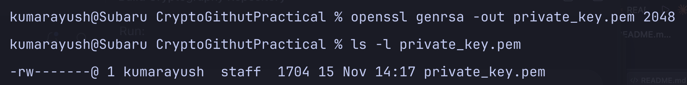
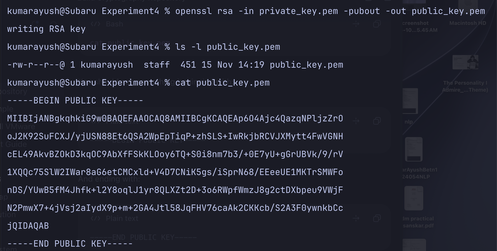
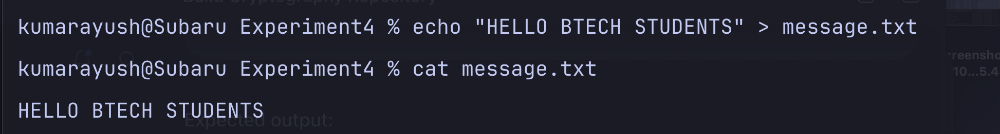
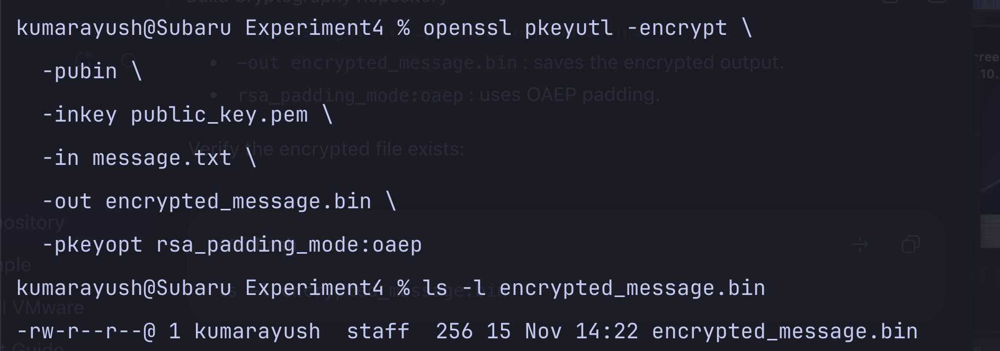
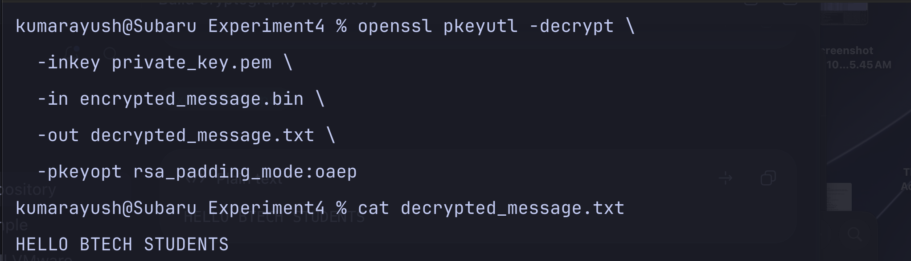

# Experiment 4: RSA Key Generation, Encryption, and Decryption

## 1. Aim

To implement the RSA (Rivest–Shamir–Adleman) asymmetric cryptosystem using OpenSSL by generating a 2048-bit RSA public-private key pair, encrypting a plaintext message using the public key with OAEP padding, and decrypting it using the private key.

## 2. Software and Tools Required

- macOS
- Terminal
- OpenSSL
- MacBook or computer

## 3. Theory

### A. Asymmetric Cryptography

Asymmetric cryptography uses two mathematically related keys:

- **Public Key:** Shared openly and used to encrypt messages.
- **Private Key:** Kept secret and used to decrypt messages.

### B. Mathematical Foundation of RSA

RSA security relies on the computational difficulty of factoring a large integer into its prime factors.

1. Select two large prime numbers, `p` and `q`.
2. Calculate the modulus: `n = p × q`.
3. Calculate Euler's totient: `φ(n) = (p − 1)(q − 1)`.
4. Choose a public exponent `e` relatively prime to `φ(n)`. A common value is 65537.
5. Calculate the private exponent `d`, satisfying `d × e ≡ 1 (mod φ(n))`.
6. The public key is represented by `(e, n)` and the private key by `(d, n)`.

OpenSSL performs these calculations automatically during key generation.

### C. RSA Encryption and Decryption

- **Encryption:** `C = M^e mod n`
- **Decryption:** `M = C^d mod n`

Where:
- `M` = Plaintext message
- `C` = Ciphertext
- `e` = Public exponent
- `d` = Private exponent
- `n` = RSA modulus

### D. OAEP Padding

OAEP (Optimal Asymmetric Encryption Padding) adds randomized padding to the message before RSA encryption. It provides stronger security than using raw RSA directly.

## 4. Working Procedure and Commands

All commands were executed using the macOS Terminal.

### Step 1: Create the experiment directory

```bash
mkdir -p ~/Cryptography/Exp04_RSA_Key_Generation
cd ~/Cryptography/Exp04_RSA_Key_Generation
```

### Step 2: Generate a 2048-bit RSA private key

```bash
openssl genrsa -out private_key.pem 2048
```

This command generates a 2048-bit RSA private key and stores it in `private_key.pem`.

### Step 3: Generate the corresponding public key

```bash
openssl rsa -in private_key.pem -pubout -out public_key.pem
```

This extracts the public key corresponding to the generated private key.

### Step 4: Create a plaintext message

```bash
echo "HELLO BTECH STUDENTS" > message.txt
```

Verify the message:

```bash
cat message.txt
```

### Step 5: Encrypt the message using the public key

```bash
openssl pkeyutl -encrypt \
  -pubin \
  -inkey public_key.pem \
  -in message.txt \
  -out encrypted_message.bin \
  -pkeyopt rsa_padding_mode:oaep
```

This encrypts the plaintext using the RSA public key and OAEP padding.

Verify the encrypted file:

```bash
ls -l encrypted_message.bin
```

For a 2048-bit RSA key, the ciphertext output is 256 bytes.

### Step 6: Decrypt the encrypted message using the private key

```bash
openssl pkeyutl -decrypt \
  -inkey private_key.pem \
  -in encrypted_message.bin \
  -out decrypted_message.txt \
  -pkeyopt rsa_padding_mode:oaep
```

Display the decrypted message:

```bash
cat decrypted_message.txt
```

Expected output:

```text
HELLO BTECH STUDENTS
```

### Step 7: Verify the decrypted message

```bash
diff message.txt decrypted_message.txt
```

No output from the `diff` command indicates that both files are identical.

## 5. Input and Output Details

| Item | File Name | Description |
|---|---|---|
| Private Key | `private_key.pem` | 2048-bit RSA private key |
| Public Key | `public_key.pem` | Corresponding RSA public key |
| Plaintext | `message.txt` | HELLO BTECH STUDENTS |
| Ciphertext | `encrypted_message.bin` | 256-byte encrypted output |
| Decrypted Text | `decrypted_message.txt` | Recovered original message |

## 6. Screenshots

### Step 1: RSA Private Key Generation



### Step 2: RSA Public Key Generation



### Step 3: Plaintext Message Creation



### Step 4: RSA Encryption Output



### Step 5: RSA Decryption Output



### Step 6: RSA Decryption Verification


## 7. Analysis and Observations

1. A 2048-bit RSA private key and its corresponding public key were successfully generated.
2. The plaintext message was encrypted using the public key.
3. The encrypted output was 256 bytes, corresponding to the 2048-bit RSA modulus.
4. The encrypted message was successfully decrypted using the corresponding private key.
5. The `diff` command produced no output, confirming that the original and decrypted files were identical.
6. OAEP padding was used during both encryption and decryption.

## 8. Result

The RSA key generation, encryption, and decryption operations were successfully performed using OpenSSL on macOS. The original plaintext message was recovered successfully after decryption.

## 9. Conclusion

This experiment demonstrated the working of the RSA asymmetric cryptographic algorithm. It showed how a public key can be used for encryption and the corresponding private key for decryption. The successful recovery of the original message verified the correctness of the encryption and decryption process.

## 10. Security Note

The RSA private key (`private_key.pem`) is confidential and must never be uploaded to a public GitHub repository. It should be excluded using `.gitignore`. The public key can be shared, but private-key material must remain secure.