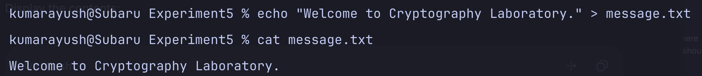
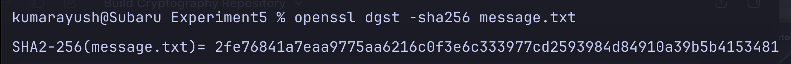
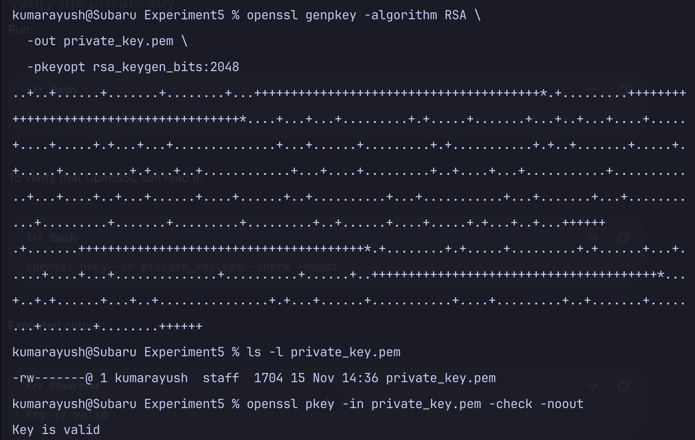
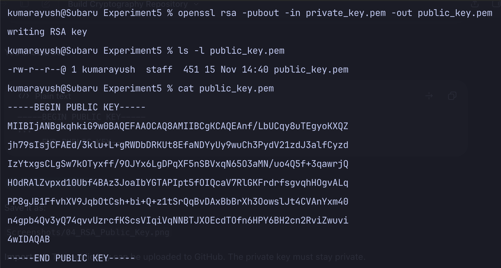
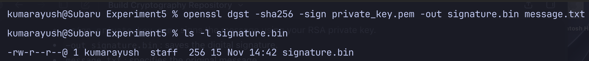
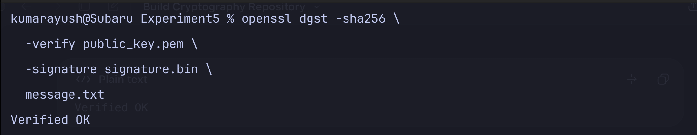
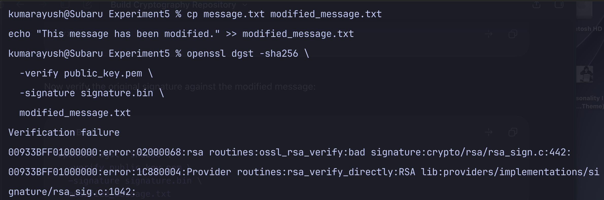

# Experiment 5: SHA-256 Hashing and Digital Signature Verification

## 1. Aim

To implement SHA-256 hashing and RSA-based digital signatures using OpenSSL on macOS. The experiment demonstrates hash generation, digital signature creation, signature verification, and detection of message modification.

## 2. Software and Tools Required

- macOS
- Terminal
- OpenSSL
- MacBook or computer

## 3. Theory

### A. Cryptographic Hash Function

A cryptographic hash function converts input data of any length into a fixed-length output called a hash or message digest.

Important properties:

- **Fixed Length:** SHA-256 always generates a 256-bit hash.
- **Deterministic:** The same input produces the same hash.
- **One-Way:** It is computationally infeasible to recover the original message from its hash.
- **Avalanche Effect:** A small change in input produces a significantly different hash.

### B. SHA-256 Algorithm

SHA-256 stands for Secure Hash Algorithm 256-bit.

- It generates a 256-bit hash value.
- The output is represented by 64 hexadecimal characters.
- It is commonly used for data integrity verification and digital signatures.

### C. Digital Signature

A digital signature is a cryptographic mechanism used to verify the authenticity and integrity of a message.

It uses two keys:

- **Private Key:** Used by the sender to generate the digital signature.
- **Public Key:** Used by the receiver to verify the signature.

### D. Working of Digital Signature

1. The sender creates a hash of the original message using SHA-256.
2. The sender signs the message using their RSA private key.
3. The receiver uses the corresponding public key to verify the signature.
4. If the message has been modified, signature verification fails.

**Note:** This experiment uses OpenSSL's default RSA signature padding for the `dgst -sign` command, which is RSASSA-PKCS1-v1_5.

## 4. Working Procedure and Commands

All commands were executed using macOS Terminal.

### Step 1: Create the experiment directory

```bash
mkdir -p ~/Cryptography/Exp05_SHA256_DigitalSignature
cd ~/Cryptography/Exp05_SHA256_DigitalSignature
```

### Step 2: Create a plaintext message

```bash
echo "Welcome to Cryptography Laboratory." > message.txt
```

Display the message:

```bash
cat message.txt
```

### Step 3: Generate SHA-256 hash

```bash
openssl dgst -sha256 message.txt
```

This command generates the SHA-256 hash of the message.

The output contains a 64-character hexadecimal hash representing 256 bits.

### Step 4: Generate RSA private key

```bash
openssl genpkey -algorithm RSA \
  -out private_key.pem \
  -pkeyopt rsa_keygen_bits:2048
```

This generates a 2048-bit RSA private key.

Verify the key:

```bash
openssl pkey -in private_key.pem -check -noout
```

Expected output:

```text
Key is valid
```

### Step 5: Generate RSA public key

```bash
openssl rsa -pubout -in private_key.pem -out public_key.pem
```

This extracts the corresponding public key from the private key.

### Step 6: Generate digital signature

```bash
openssl dgst -sha256 -sign private_key.pem -out signature.bin message.txt
```

This command:

- Calculates the SHA-256 digest of the message.
- Uses the RSA private key to generate a digital signature.
- Saves the signature in `signature.bin`.

Verify the signature file:

```bash
ls -l signature.bin
```

For a 2048-bit RSA key, the signature size is 256 bytes.

### Step 7: Verify the digital signature

```bash
openssl dgst -sha256 \
  -verify public_key.pem \
  -signature signature.bin \
  message.txt
```

Expected output:

```text
Verified OK
```

This confirms that the signature is valid for the original message and the corresponding public key.

### Step 8: Modify the original message

Create a modified copy:

```bash
cp message.txt modified_message.txt
echo "This message has been modified." >> modified_message.txt
```

Verify the original signature against the modified message:

```bash
openssl dgst -sha256 \
  -verify public_key.pem \
  -signature signature.bin \
  modified_message.txt
```

Expected output:

```text
Verification failure
```

This demonstrates that modifying the original message causes signature verification to fail.

## 5. Screenshots

### 1. Plaintext Message Creation



### 2. SHA-256 Hash Generation



### 3. RSA Private Key Generation



### 4. RSA Public Key Generation



### 5. Digital Signature Generation



### 6. Digital Signature Verification



### 7. Modified Message Verification



## 6. Analysis and Observations

1. SHA-256 successfully generated a 256-bit hash of the original message.
2. A 2048-bit RSA private key and its corresponding public key were generated.
3. The original message was digitally signed using the RSA private key.
4. Signature verification using the public key returned `Verified OK`.
5. After modifying the message, verification returned `Verification failure`.
6. This demonstrates that digital signatures help detect unauthorized changes to messages.

## 7. Result

SHA-256 hashing and RSA-based digital signature generation and verification were successfully performed using OpenSSL on macOS. The original message passed signature verification, while the modified message failed verification.

## 8. Conclusion

This experiment demonstrated the use of SHA-256 for generating cryptographic hashes and RSA for digital signature generation and verification. It showed how digital signatures provide message integrity and authentication. The modified-message test confirmed that unauthorized changes can be detected through signature verification.

## 9. Security Note

- The RSA private key (`private_key.pem`) must remain confidential.
- Never upload the private key to a public GitHub repository.
- The public key (`public_key.pem`) can be shared.
- Digital signatures provide integrity and authentication, not message confidentiality.