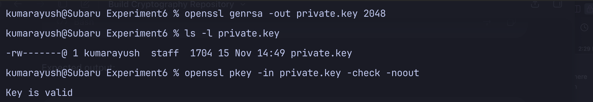
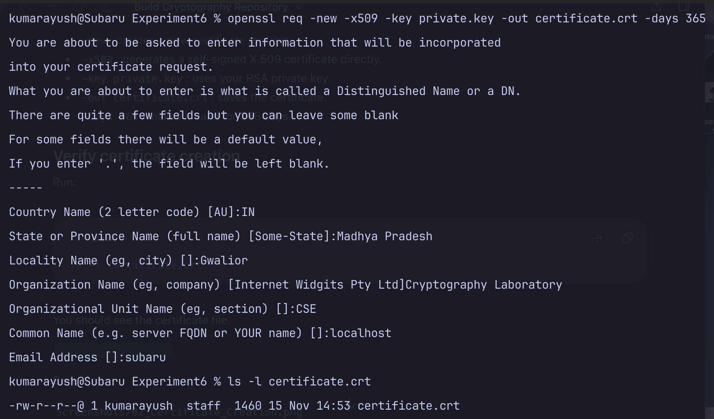
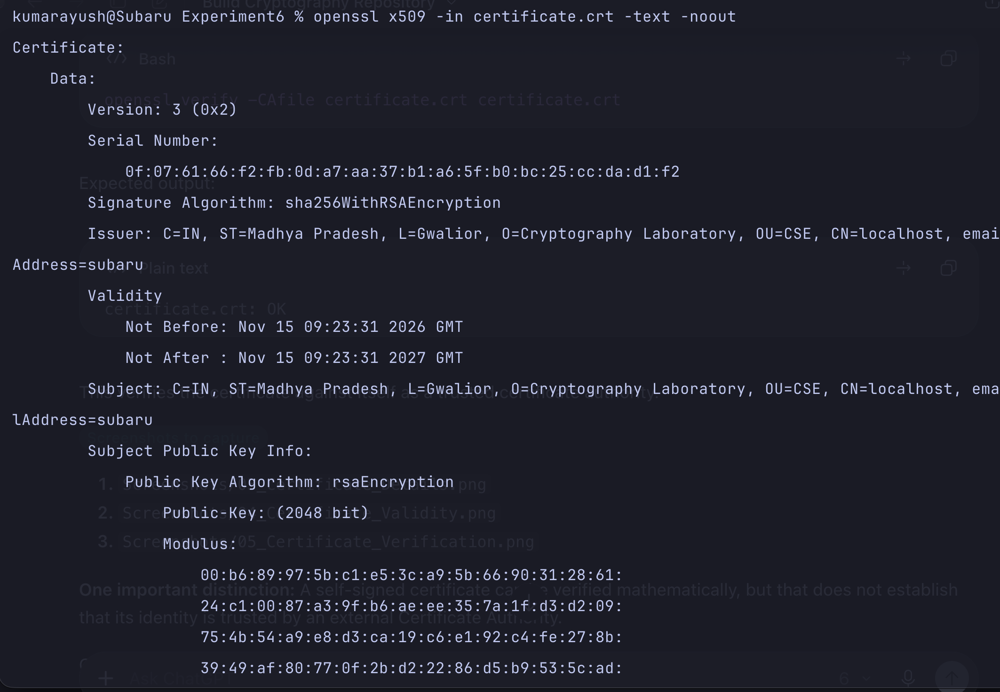
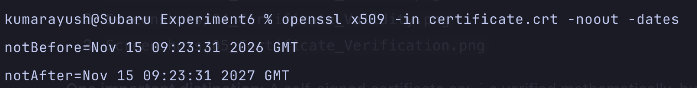
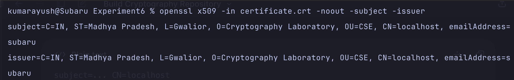
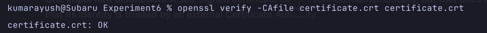

# Experiment 6: Create and Inspect Self-Signed X.509 Digital Certificates

## 1. Aim

To generate a self-signed X.509 digital certificate using OpenSSL, inspect its details, verify its validity period, and perform certificate verification on macOS.

## 2. Requirements

- macOS
- OpenSSL
- Terminal
- MacBook or computer

## 3. Introduction

An X.509 digital certificate is an electronic document that associates an identity with a public key. It contains information such as the certificate owner, issuer, public key, validity period, and digital signature.

X.509 certificates are commonly used in HTTPS, SSL, and TLS to support secure communication over networks.

A self-signed certificate is a certificate signed using its own corresponding private key instead of being issued by an external Certificate Authority (CA).

## 4. Working Procedure and Commands

All commands were executed using macOS Terminal.

### Step 1: Generate a 2048-bit RSA Private Key

Command:

```bash
openssl genrsa -out private.key 2048
```

This command generates a 2048-bit RSA private key and saves it in `private.key`.

Verify the generated key:

```bash
ls -l private.key
```

Check whether the key is valid:

```bash
openssl pkey -in private.key -check -noout
```

Expected output:

```text
Key is valid
```

### Step 2: Create a Self-Signed X.509 Certificate

Command:

```bash
openssl req -new -x509 -key private.key -out certificate.crt -days 365
```

OpenSSL prompts for certificate information, including:

- Country Name
- State or Province
- Locality
- Organization
- Organizational Unit
- Common Name
- Email Address

The following details were entered during certificate creation:

| Field | Entered Value |
|---|---|
| Country | IN |
| State | Madhya Pradesh |
| Locality | Gwalior |
| Organization | Cryptography Laboratory |
| Organizational Unit | CSE |
| Common Name | localhost |
| Email Address | subaru |

The command generates a self-signed certificate valid for 365 days and saves it as `certificate.crt`.

Verify certificate creation:

```bash
ls -l certificate.crt
```

### Step 3: Inspect the Certificate Details

Command:

```bash
openssl x509 -in certificate.crt -text -noout
```

This command displays the certificate information in readable form.

Important certificate attributes include:

- Version
- Serial Number
- Signature Algorithm
- Issuer
- Validity Period
- Subject
- Public Key Algorithm
- Public Key
- Signature Value

### Step 4: Check the Certificate Validity Period

Command:

```bash
openssl x509 -in certificate.crt -noout -dates
```

The command displays:

- `notBefore`: Date and time from which the certificate is valid.
- `notAfter`: Date and time when the certificate expires.

The generated certificate has a validity period of 365 days.

### Step 5: Display Certificate Subject and Issuer

Command:

```bash
openssl x509 -in certificate.crt -noout -subject -issuer
```

The command displays the Subject and Issuer information.

- **Subject:** Identifies the entity represented by the certificate.
- **Issuer:** Identifies the entity that issued and signed the certificate.

Since this is a self-signed certificate, the Subject and Issuer are the same.

### Step 6: Verify the Self-Signed Certificate

Command:

```bash
openssl verify -CAfile certificate.crt certificate.crt
```

Expected output:

```text
certificate.crt: OK
```

This verifies the certificate against itself as a trusted certificate for this test.

## 5. Screenshots

### 1. RSA Private Key Generation



### 2. Self-Signed Certificate Creation



### 3. Certificate Details Inspection



### 4. Certificate Validity Period



### 5. Certificate Subject and Issuer



### 6. Certificate Verification



## 6. Analysis and Observations

1. A 2048-bit RSA private key was successfully generated using OpenSSL.
2. A self-signed X.509 certificate was created using the generated private key.
3. The certificate was successfully inspected, displaying its Subject, Issuer, Serial Number, Public Key, and Signature Algorithm.
4. The certificate validity period was confirmed to be 365 days.
5. The Subject and Issuer fields contained the same identity information, confirming that the certificate was self-signed.
6. Certificate verification returned `certificate.crt: OK`.

## 7. Result

A self-signed X.509 digital certificate was successfully generated and inspected using OpenSSL on macOS. Its certificate details, validity period, Subject, and Issuer were examined, and certificate verification was successful.

## 8. Conclusion

This experiment demonstrated the creation and inspection of a self-signed X.509 digital certificate using OpenSSL. It provided an understanding of certificate attributes, public-key association, certificate validity, and self-signing. The successful verification confirmed that the generated certificate could be validated against itself.

## 9. Security Note

- The private key (`private.key`) is confidential and must never be uploaded to a public GitHub repository.
- The certificate (`certificate.crt`) contains public-key and identity information and can be shared.
- A self-signed certificate being mathematically valid does not mean its identity is trusted by an external Certificate Authority.
- Private keys should be excluded using `.gitignore`.