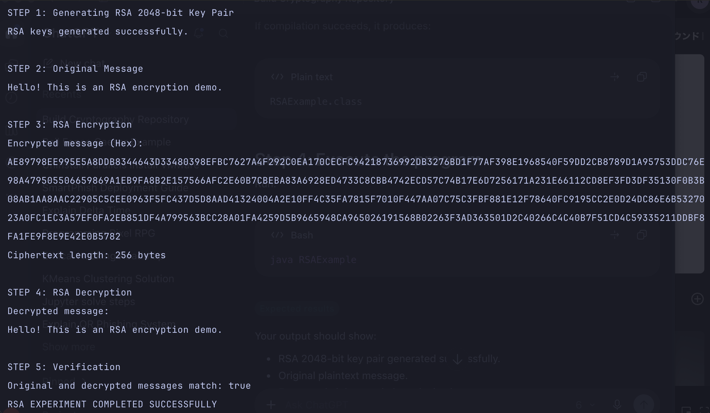
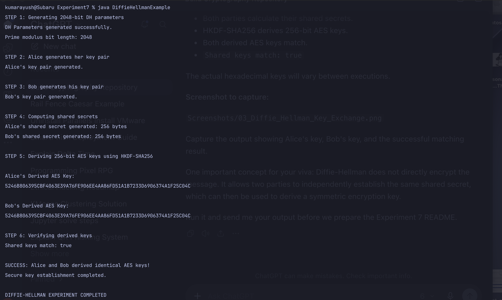

# Experiment 7: Implementation of RSA and Diffie-Hellman Using Java

## 1. Aim

To implement RSA encryption and decryption and Diffie-Hellman key exchange using Java. The experiment demonstrates asymmetric encryption, secure key exchange, and AES key derivation using HKDF-SHA256.

## 2. Software and Tools Required

- macOS
- Java Development Kit (JDK)
- Visual Studio Code
- Java Cryptography Architecture (JCA)

## 3. Theory

### A. RSA Algorithm

RSA (Rivest-Shamir-Adleman) is an asymmetric cryptographic algorithm that uses two mathematically related keys:

- **Public Key:** Used for encryption.
- **Private Key:** Used for decryption.

RSA encryption and decryption are based on modular arithmetic and the computational difficulty of factoring large integers.

The general mathematical representation is:

**Encryption:**

`C = M^e mod n`

**Decryption:**

`M = C^d mod n`

Where:

- `M` = Original message
- `C` = Ciphertext
- `e` = Public exponent
- `d` = Private exponent
- `n` = RSA modulus

In this experiment, RSA uses a 2048-bit key pair and OAEP padding with SHA-256.

### B. Diffie-Hellman Key Exchange

Diffie-Hellman is a cryptographic key exchange algorithm that allows two parties to establish a common secret over an insecure communication channel.

The two participants are:

- Alice
- Bob

Both participants generate their own private and public keys and exchange their public keys.

They independently calculate the same shared secret using their private key and the other participant's public key.

The mathematical representation is:

- Alice's public value: `A = g^a mod p`
- Bob's public value: `B = g^b mod p`
- Alice's shared secret: `S = B^a mod p`
- Bob's shared secret: `S = A^b mod p`

Both participants obtain the same shared secret.

### C. HKDF-SHA256

HKDF stands for HMAC-based Key Derivation Function.

It derives cryptographic keys from an existing shared secret.

In this experiment:

- HKDF uses HMAC-SHA256.
- The shared secret is used as the input keying material.
- A context string is used during key expansion.
- A 256-bit AES key is derived for each participant.

Both participants should derive identical AES keys.

## 4. Experiment 7A: RSA Encryption and Decryption Using Java

### Step 1: Create the Java source file

Create a file named:

`RSAExample.java`

### Step 2: Generate RSA key pair

The program uses Java's `KeyPairGenerator` to generate a 2048-bit RSA public-private key pair.

### Step 3: Define the plaintext message

The original message used in the program is:

```text
Hello! This is an RSA encryption demo.
```

### Step 4: Encrypt the message

The program uses the RSA public key and OAEP padding with SHA-256 to encrypt the original message.

The encrypted ciphertext is displayed in hexadecimal format.

### Step 5: Decrypt the message

The ciphertext is decrypted using the corresponding RSA private key.

### Step 6: Verify the result

The program compares the original and decrypted messages.

Expected verification:

```text
Original and decrypted messages match: true
RSA EXPERIMENT COMPLETED SUCCESSFULLY
```

### RSA Program Execution

Compile the program:

```bash
javac RSAExample.java
```

Execute the program:

```bash
java RSAExample
```

## 5. Experiment 7B: Diffie-Hellman Key Exchange Using Java

### Step 1: Create the Java source file

Create a file named:

`DiffieHellmanExample.java`

### Step 2: Generate Diffie-Hellman parameters

The program generates 2048-bit Diffie-Hellman parameters using Java's `AlgorithmParameterGenerator`.

### Step 3: Generate Alice's key pair

Alice generates her own private and public key pair using the generated Diffie-Hellman parameters.

### Step 4: Generate Bob's key pair

Bob independently generates his private and public key pair using the same parameters.

### Step 5: Calculate the shared secret

Alice uses her private key and Bob's public key to calculate a shared secret.

Bob uses his private key and Alice's public key to calculate the same shared secret.

### Step 6: Derive AES keys using HKDF-SHA256

The program uses HKDF-SHA256 to derive a 256-bit AES key from each participant's shared secret.

The same context information is used during key derivation.

### Step 7: Verify the derived keys

The program compares Alice's and Bob's derived AES keys using `Arrays.equals()`.

Expected verification:

```text
Shared keys match: true

SUCCESS: Alice and Bob derived identical AES keys!
Secure key establishment completed.
```

### Diffie-Hellman Program Execution

Compile the program:

```bash
javac DiffieHellmanExample.java
```

Execute the program:

```bash
java DiffieHellmanExample
```

## 6. Screenshots

### 1. RSA Encryption and Decryption

The screenshot demonstrates RSA key generation, message encryption, ciphertext generation, decryption, and successful verification.



### 2. Diffie-Hellman Key Exchange

The screenshot demonstrates 2048-bit parameter generation, Alice's and Bob's key pair generation, shared-secret calculation, HKDF-SHA256 key derivation, and successful key matching.



## 7. Analysis and Observations

### RSA

1. A 2048-bit RSA key pair was successfully generated.
2. The original message was encrypted using the public key.
3. The ciphertext was 256 bytes long.
4. The encrypted message was successfully decrypted using the private key.
5. The original and decrypted messages matched successfully.

### Diffie-Hellman

1. 2048-bit Diffie-Hellman parameters were successfully generated.
2. Alice and Bob generated their own key pairs.
3. Both participants independently calculated their shared secrets.
4. HKDF-SHA256 derived 256-bit AES keys from the shared secrets.
5. Both derived AES keys were identical.

## 8. Result

RSA encryption and decryption were successfully implemented using Java. The original message was recovered after decryption.

The Diffie-Hellman key exchange was also successfully implemented. Alice and Bob independently derived identical 256-bit AES keys using HKDF-SHA256.

## 9. Conclusion

This experiment demonstrated two important cryptographic techniques using Java.

RSA demonstrated asymmetric encryption and decryption using public and private keys. Diffie-Hellman demonstrated how two parties can establish a common secret without directly transmitting that secret.

The successful verification of the original RSA message and matching Diffie-Hellman-derived AES keys confirmed the correct execution of both programs.

## 10. Security Note

- RSA private keys must remain confidential.
- Diffie-Hellman public keys should be authenticated in real-world communication to prevent man-in-the-middle attacks.
- The experiment demonstrates key establishment, not actual AES message encryption.
- Cryptographic parameters and keys should be handled securely in practical applications.