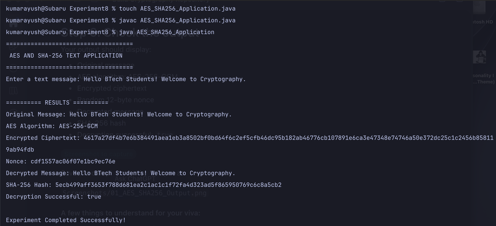

# Experiment 8: AES-256 and SHA-256 Text Message Application Using Java

## 1. Aim

To develop a Java-based text message application that implements AES-256-GCM encryption and decryption and SHA-256 hashing for secure message processing.

## 2. Software and Tools Required

- macOS
- Java Development Kit (JDK)
- Visual Studio Code
- Java Cryptography Architecture (JCA)

## 3. Theory

### A. AES (Advanced Encryption Standard)

AES is a symmetric-key encryption algorithm used to protect digital information.

It uses the same secret key for both encryption and decryption.

AES supports three key sizes:

- AES-128
- AES-192
- AES-256

In this experiment, AES-256 is used with a 256-bit secret key.

### B. GCM (Galois/Counter Mode)

GCM is an authenticated encryption mode used with AES.

It provides:

- **Confidentiality:** Protects the original message from unauthorized access.
- **Integrity:** Detects unauthorized modification of encrypted data.
- **Authentication:** Uses an authentication tag to validate the encrypted data.

The experiment uses a 12-byte nonce and a 128-bit authentication tag.

### C. SHA-256 (Secure Hash Algorithm)

SHA-256 is a cryptographic hash function that converts input data into a fixed-length 256-bit hash value.

Important properties:

- Produces a 256-bit output.
- The same input always produces the same hash.
- Small changes in input produce significantly different hashes.
- It is computationally infeasible to recover the original message from its hash.

The SHA-256 output is represented by 64 hexadecimal characters.

## 4. Working Procedure and Commands

All commands were executed using macOS Terminal.

### Step 1: Create the experiment directory

```bash
mkdir -p ~/Cryptography/Exp08_AES_SHA256_Application
cd ~/Cryptography/Exp08_AES_SHA256_Application
```

### Step 2: Create the Java source file

Create a Java file named:

`AES_SHA256_Application.java`

### Step 3: Generate the AES-256 key

The application uses Java's `KeyGenerator` class to generate a random 256-bit AES secret key.

### Step 4: Generate the nonce

A random 12-byte nonce is generated using `SecureRandom`.

The nonce is required by AES-GCM during encryption and decryption.

### Step 5: Encrypt the message

The application uses:

```java
Cipher.getInstance("AES/GCM/NoPadding");
```

The original text message is encrypted using the generated AES key and nonce.

The encrypted ciphertext is displayed in hexadecimal format.

### Step 6: Decrypt the message

The ciphertext is decrypted using the same AES key and nonce.

The recovered plaintext is displayed.

### Step 7: Generate the SHA-256 hash

The application uses:

```java
MessageDigest.getInstance("SHA-256");
```

This generates a 256-bit hash of the original message.

### Step 8: Compile the Java program

```bash
javac AES_SHA256_Application.java
```

### Step 9: Execute the application

```bash
java AES_SHA256_Application
```

### Input Message

```text
Hello BTech Students! Welcome to Cryptography.
```

## 5. Output and Screenshots

### AES-256 and SHA-256 Application Output

The application successfully performed AES-256-GCM encryption, decryption, nonce generation, and SHA-256 hash generation.

The decrypted message matched the original message.



## 6. Analysis and Observations

1. A random 256-bit AES secret key was successfully generated.
2. A random 12-byte nonce was generated for AES-GCM.
3. The original plaintext message was successfully encrypted.
4. The encrypted ciphertext was displayed in hexadecimal format.
5. The ciphertext was successfully decrypted using the same secret key and nonce.
6. The original and decrypted messages matched successfully.
7. SHA-256 generated a 256-bit hash represented by 64 hexadecimal characters.
8. AES-GCM provided authenticated encryption using its authentication tag.

## 7. Result

The AES-256-GCM encryption and decryption operations and SHA-256 hashing were successfully implemented using Java. The original message was recovered successfully after decryption.

## 8. Conclusion

This experiment demonstrated the implementation of symmetric encryption and cryptographic hashing using Java.

AES-256-GCM was used to provide message confidentiality and integrity, while SHA-256 generated a fixed-length cryptographic hash of the original message.

The successful recovery of the original message confirmed that the encryption and decryption operations worked correctly.

## 9. Security Note

- AES secret keys must remain confidential.
- A nonce must never be reused with the same AES-GCM key.
- The authentication tag must be verified during decryption.
- SHA-256 hashing does not provide encryption or confidentiality.
- Cryptographic keys should be stored securely in real-world applications.