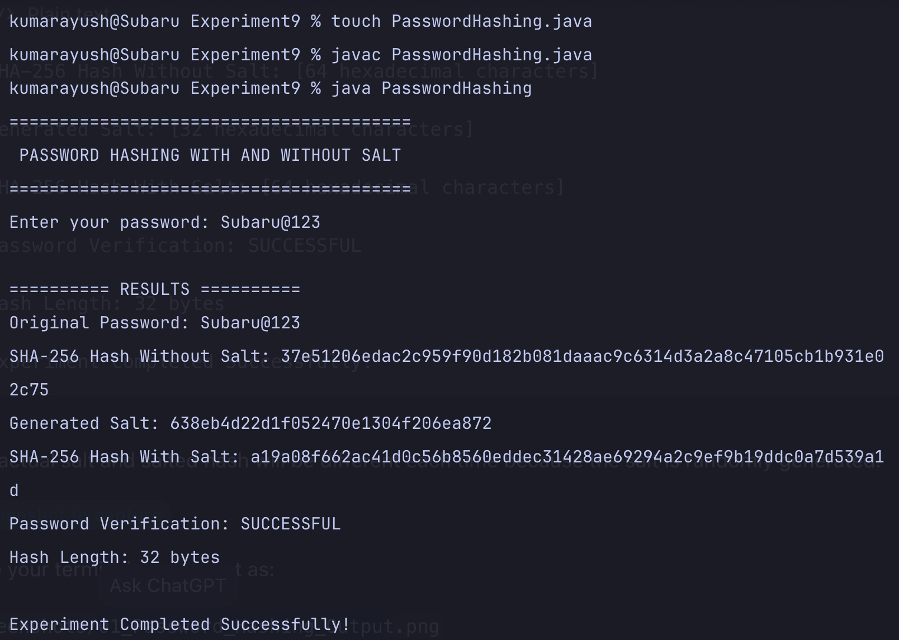

# Experiment 9: Password Hashing with and without Salt

## 1. Aim

To implement password hashing using SHA-256 and compare password hashing with and without a randomly generated salt using Java.

## 2. Software and Tools Required

- macOS
- Java Development Kit (JDK)
- Visual Studio Code
- Java Cryptography Architecture (JCA)

## 3. Theory

### A. Password Hashing

Password hashing converts a password into a fixed-length hash value using a cryptographic hash function.

Instead of storing the original password, systems can store its hash and verify passwords by hashing the entered value and comparing the results.

### B. SHA-256

SHA-256 (Secure Hash Algorithm 256-bit) is a cryptographic hash function that generates a 256-bit output.

Important properties:

- Produces a fixed-length 256-bit hash.
- The same input produces the same hash.
- Small changes in input produce different hash values.
- It is computationally infeasible to recover the original input from the hash.

### C. Password Hashing Without Salt

In unsalted password hashing, the password is directly passed through the SHA-256 algorithm.

Identical passwords produce identical hash values.

### D. Password Hashing With Salt

A salt is a randomly generated value added to a password before hashing.

In this experiment:

- A random 16-byte salt is generated.
- The salt is combined with the password.
- SHA-256 is applied to the combined data.

Using different salts for identical passwords produces different hash values.

## 4. Working Procedure and Commands

All commands were executed using macOS Terminal.

### Step 1: Create the experiment directory

```bash
mkdir -p ~/Cryptography/Exp09_Password_Hashing_Salting
cd ~/Cryptography/Exp09_Password_Hashing_Salting
```

### Step 2: Create the Java source file

Create a file named:

`PasswordHashing.java`

### Step 3: Enter the password

The program accepts a password from the user through the Java Scanner class.

### Step 4: Generate SHA-256 hash without salt

The password is converted into UTF-8 bytes and passed to the SHA-256 MessageDigest algorithm.

The resulting hash is displayed in hexadecimal format.

### Step 5: Generate a random salt

The program uses Java's `SecureRandom` class to generate a random 16-byte salt.

### Step 6: Generate SHA-256 hash with salt

The salt is combined with the password, and SHA-256 is applied to the combined byte array.

### Step 7: Verify the password

The program combines the entered password with the same salt and generates its SHA-256 hash again.

The generated hash is compared with the previously stored salted hash using `MessageDigest.isEqual()`.

### Step 8: Compile the program

```bash
javac PasswordHashing.java
```

### Step 9: Execute the program

```bash
java PasswordHashing
```

## 5. Screenshots

### Password Hashing with and without Salt

The screenshot demonstrates password input, unsalted SHA-256 hashing, random salt generation, salted SHA-256 hashing, and successful password verification.



## 6. Analysis and Observations

1. The password was successfully converted into a SHA-256 hash.
2. A random 16-byte salt was generated using SecureRandom.
3. The password and salt were combined before hashing.
4. The salted and unsalted hash values were different.
5. The SHA-256 hash length was 32 bytes (256 bits).
6. Password verification was successful when the same password and salt were used.

## 7. Result

Password hashing with and without salt was successfully implemented using Java and SHA-256. The program generated a random 16-byte salt and successfully verified the password using the salted hash.

## 8. Conclusion

This experiment demonstrated the importance of salting in password hashing. It showed that adding a random salt produces different hash values for identical passwords, making precomputed hash attacks such as rainbow-table attacks more difficult.

## 9. Security Note

- Salts should be randomly generated and stored alongside their corresponding password hashes.
- Salts do not need to be secret.
- SHA-256 alone is not recommended for production password storage because it is too fast.
- Real-world password storage should use dedicated password hashing algorithms such as Argon2id, scrypt, or PBKDF2.